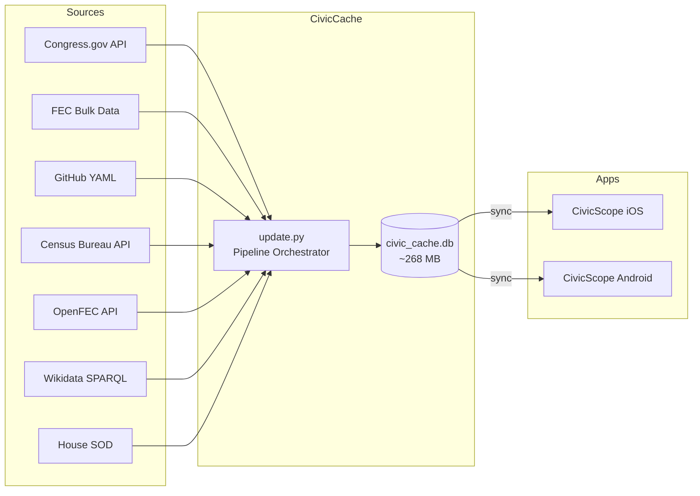
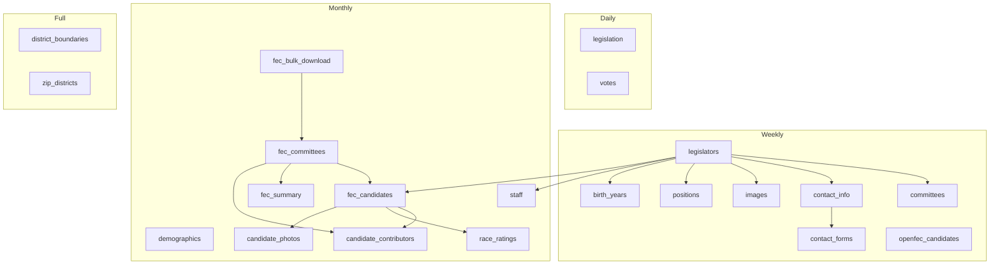

# CivicCache

Data pipeline and SQLite database for U.S. Congressional and campaign finance data. Powers the [CivicScope](https://github.com/cczaphod/CivicScope) iOS and Android applications.

## What It Does

CivicCache extracts data from government APIs and FEC bulk files, processes it into a normalized SQLite database, and syncs the result to the CivicScope mobile apps. The database ships as a pre-built asset for offline-first mobile use.



## Data Coverage

| Domain | Records | Source |
|--------|--------:|--------|
| Congress members (119th) | 537 | Congress.gov, GitHub YAML |
| Legislation (119th) | 13,574 | Congress.gov API |
| Roll-call votes | 438 | Congress.gov API |
| Member vote positions | 188,516 | Congress.gov API |
| FEC candidates (all cycles) | 129,954 | FEC Bulk Data |
| FEC committees | 85,397 | FEC Bulk Data |
| Election races (derived) | 12,470 | FEC Bulk Data |
| Race candidates | 136,842 | FEC Bulk Data |
| Congressional staff | 17,444 | House SOD |
| Congressional districts | 444 | Census TIGER/Line |
| District demographics | 436 | Census ACS 5-Year |
| ZIP-to-district mappings | 42,033 | Census |

See [docs/DATABASE.md](docs/DATABASE.md) for full schema documentation.

## Pipeline Architecture

The pipeline is managed by `scripts/update.py` with four tiers:



### Pipeline Commands

```bash
# Run by tier (each tier includes all lower tiers)
python3 scripts/update.py daily
python3 scripts/update.py weekly
python3 scripts/update.py monthly
python3 scripts/update.py full

# Run a single stage
python3 scripts/update.py --stage fec_candidates

# Preview what would run
python3 scripts/update.py monthly --dry-run

# Health check
python3 scripts/update.py --check

# List all stages
python3 scripts/update.py --list-stages
```

## Project Structure

```
CivicCache/
├── scripts/
│   ├── config.py                       # Shared configuration (paths, API keys)
│   ├── utils.py                        # Shared utilities (HTTP, DB connection)
│   ├── update.py                       # Pipeline orchestrator
│   ├── build_database.py               # Schema creation (28 tables)
│   │
│   ├── import_congress_legislators.py   # Members from GitHub YAML
│   ├── import_legislation.py            # Bills from Congress.gov
│   ├── import_votes.py                  # Roll-call votes
│   ├── import_member_contact_info.py    # Contact info
│   ├── import_member_images.py          # Official portraits
│   ├── import_member_positions.py       # Career positions
│   ├── import_birth_years.py            # Birth year data
│   ├── import_committees.py             # Committee assignments
│   ├── import_congressional_staff.py    # Staff from House SOD
│   ├── fill_contact_forms.py            # Contact form URL discovery
│   │
│   ├── download_fec_bulk.py             # FEC bulk file download + extract
│   ├── import_fec_candidates.py         # FEC candidate master + races
│   ├── import_fec_committees.py         # FEC committee master
│   ├── import_fec_summary.py            # Member financial summaries + top contributors
│   ├── import_candidate_contributors.py # PAC contributors for all candidates
│   ├── import_candidate_photos.py       # Photos from Wikidata SPARQL
│   ├── import_openfec_candidates.py     # Weekly OpenFEC API updates
│   ├── import_race_ratings.py           # Race competitiveness ratings
│   │
│   ├── import_district_boundaries.py    # GeoJSON district polygons
│   ├── import_district_demographics.py  # Census demographic data
│   └── import_zip_districts.py          # ZIP-to-district mappings
│
├── data/
│   ├── civic_cache.db                   # SQLite database (~283 MB)
│   └── raw/                             # Downloaded source data
│       ├── congress/                    # Congress.gov JSON files
│       └── fec/                         # Extracted FEC text files
│
├── FEC-Bulk-Data/                       # FEC bulk download ZIPs
│   ├── All-Candidates/
│   ├── Candidate-Master/
│   ├── Committee-Master/
│   ├── Contributions-from-Committees/
│   ├── Contributions-by-Individuals/
│   └── Candidate-Committee-Linkages/
│
├── launchd/                             # macOS automation plists
│
├── docs/
│   ├── DATABASE.md                      # Full schema reference
│   ├── API_KEY_SETUP.md                 # API key registration guide
│   ├── ADDITIONAL_DATA_SOURCES.md       # Future data source ideas
│   ├── CANDIDATE_PHOTO_ENRICHMENT.md    # Multi-source photo pipeline plan
│   └── archive/                         # Completed/superseded documents
│
└── .env                                 # API keys (not committed)
```

## Data Sources

### Active Sources

| Source | What | API Key | Rate Limit |
|--------|------|---------|------------|
| [Congress.gov API](https://api.congress.gov/) | Legislation, votes, member metadata | `CONGRESS_GOV_API_KEY` | 5,000/hour |
| [FEC Bulk Data](https://www.fec.gov/data/browse-data/?tab=bulk-data) | Candidates, committees, contributions | None | N/A (bulk files) |
| [OpenFEC API](https://api.open.fec.gov/) | Weekly candidate updates | `OPENFEC_API_KEY` | 1,000/hour |
| [Census Bureau API](https://api.census.gov/) | District demographics | `CENSUS_API_KEY` | None |
| [GitHub YAML](https://github.com/unitedstates/congress-legislators) | Member directory, committee assignments | None | N/A |
| [Wikidata SPARQL](https://query.wikidata.org/) | Candidate photos | None | Respectful use |
| House SOD | Congressional staff | None | Published quarterly |

See [docs/API_KEY_SETUP.md](docs/API_KEY_SETUP.md) for key registration instructions.

### Environment Variables

```bash
# Required
CONGRESS_GOV_API_KEY=your_key    # Congress.gov API

# Optional (for specific stages)
OPENFEC_API_KEY=your_key         # OpenFEC weekly updates
CENSUS_API_KEY=your_key          # District demographics
```

## Setup

```bash
git clone https://github.com/cczaphod/CivicCache.git
cd CivicCache

# Create .env with API keys
cp .env.example .env
# Edit .env with your keys

# Build schema (creates empty tables)
python3 scripts/build_database.py --schema-only

# Run full pipeline
python3 scripts/update.py full
```

### Requirements

- Python 3.11+
- No external Python packages required (uses only stdlib: `urllib`, `sqlite3`, `zipfile`, `json`, `xml`)

## Database Sync

The database is synced to both mobile apps after pipeline runs:

| Destination | Path |
|------------|------|
| Source | `data/civic_cache.db` |
| iOS | `CivicScope/CivicScope/Resources/civic_cache.db` |
| Android | `CivicScope.android/app/src/main/assets/civic_cache.db` |

The sync process vacuums the database (283 MB -> 268 MB) and copies to both targets.

## Related Projects

| Project | Description |
|---------|-------------|
| **CivicScope** | iOS and Android apps for civic engagement |
| **ExecutiveCache** | Presidential documents data pipeline |
| **JudicialCache** | Supreme Court and federal judiciary data pipeline |

## License

Source code: MIT. Data: public domain under 17 U.S.C. 105.
