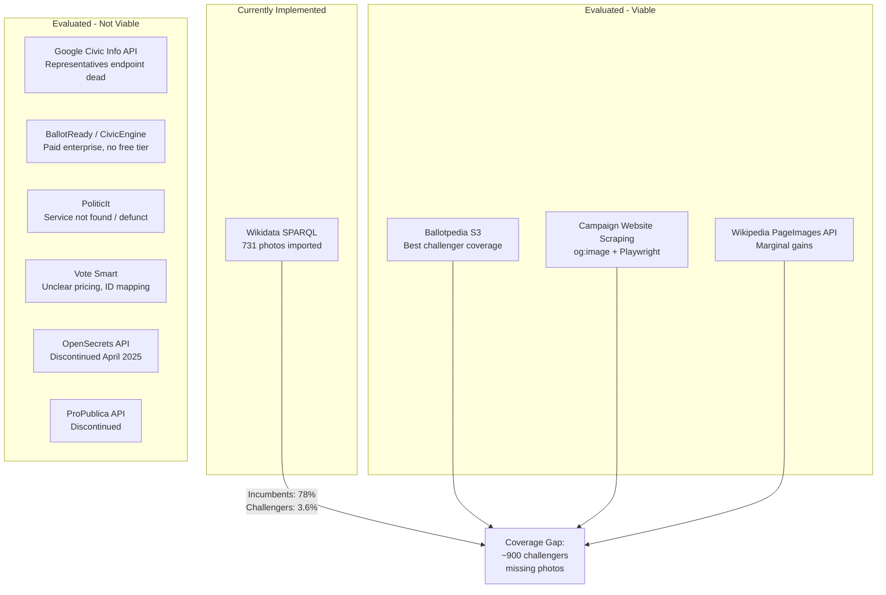
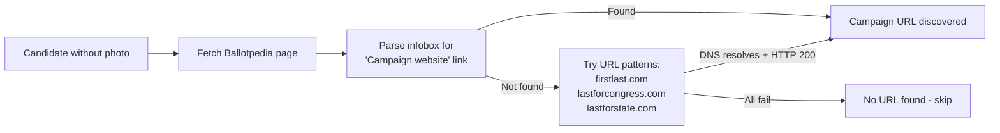
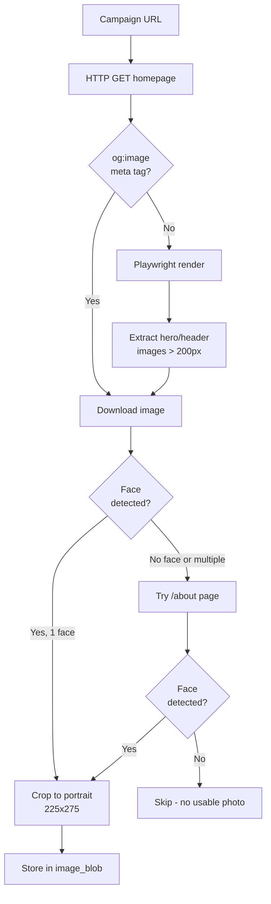
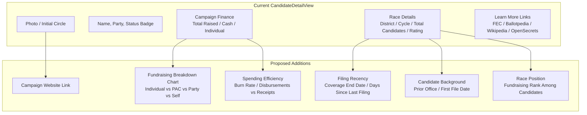
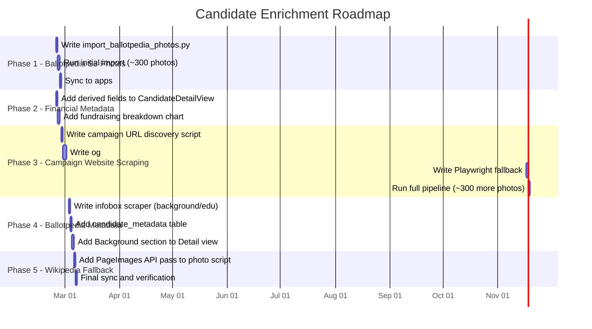

# Candidate Photo & Metadata Enrichment Plan

## Problem Statement

Photo coverage for 2026 candidates is heavily skewed toward incumbents. Scoped to the **top 3 candidates per race** (by total receipts) -- the candidates users actually care about -- the numbers tell a clear story:

| Scope | Total | With Photo | Coverage |
|-------|------:|----------:|---------:|
| Top 1 per race (frontrunners) | 528 | 363 | **68.8%** |
| Top 2 per race | 1,035 | 460 | **44.4%** |
| Top 3 per race | 1,519 | 512 | **33.7%** |

The gap is entirely in challengers:

| Status | Top-3 Count | With Photo | Coverage |
|--------|------------:|----------:|---------:|
| Incumbent | 608 | 476 | **78.3%** |
| Challenger | 774 | 28 | **3.6%** |
| Open Seat | 127 | 6 | **4.7%** |

At the race level, looking at the top 2 candidates per contest:

| Race Coverage | Count |
|---------------|------:|
| Both have photos | 55 |
| Only one has photo | 350 |
| Neither has photo | 123 |

**Only 10.4% of races have photos for both leading candidates.** Users comparing candidates in a race almost always see one photo and one colored-initial placeholder.

---

## Source Comparison

### Sources Evaluated



### Detailed Comparison

| Criterion | Wikidata (current) | Ballotpedia S3 | Campaign Website Scraping | Google Civic API | BallotReady |
|-----------|-------------------|----------------|--------------------------|-----------------|-------------|
| **Challenger coverage** | ~3.6% | **~40-50%** | **~55-65%** | ~0% | Unknown |
| **Cost** | Free | Free | Free | Free | Enterprise pricing |
| **FEC ID lookup** | Yes (P1839) | No (name-based URL) | No (URL discovery needed) | No | No |
| **Legal risk** | None (CC/PD) | Low (fair use) | Low (fair use) | N/A (ToS prohibits caching) | N/A (ToS prohibits scraping) |
| **Implementation effort** | Done | Low (~1 day) | Medium (~3 days) | N/A | N/A |
| **Image consistency** | Mixed (Wikimedia) | Consistent (~200x300) | Requires post-processing | N/A | N/A |
| **Maintenance burden** | None (SPARQL query) | Low (name derivation) | Medium (site changes) | N/A | N/A |

### Why Not Google Civic Information API

The Representatives endpoint -- which was the only one returning `photoUrl` for officials -- was **shut down on April 30, 2025**. The surviving `voterInfoQuery` endpoint has a `photoUrl` field on candidates, but:

- Photo population is extremely sparse (historically ~5.8% with many broken links)
- No FEC ID lookup -- requires address-based queries with fuzzy name matching
- ToS explicitly prohibits permanent storage (max 24-30 day cache)
- Cannot enumerate all candidates -- requires querying from voter addresses per district

**Verdict: Not viable.** Would add complexity with near-zero photo yield.

### Why Not BallotReady

BallotReady (CivicEngine API) has comprehensive candidate data including headshots, but:

- **No free tier** -- enterprise pricing only, requires sales conversation
- **ToS explicitly prohibits scraping** and redistribution without commercial license
- **No FEC ID lookup** -- primary query is by address/lat-lon
- Photos hosted on external platforms (Google Photos, Imgur) with no deterministic URL pattern

**Verdict: Not viable without a paid agreement.** Good data, wrong access model.

### Why Not PoliticIt

No active service found under this name. Web searches for "PoliticIt candidate photos", "PoliticIt API", "Politic.it", and similar variations returned no relevant results. The service appears to be either defunct or does not exist as a candidate data provider.

**Verdict: Not viable.** Service not found.

---

## Recommended Multi-Source Pipeline

```mermaid
flowchart TB
    START[race_candidates<br/>Top 3 per race<br/>1,519 candidates] --> CHECK{Has photo<br/>already?}
    CHECK -->|Yes: 512| DONE[Done<br/>No action needed]
    CHECK -->|No: 1,007| T1

    subgraph "Tier 1: Wikidata (already runs)"
        T1[Wikidata SPARQL<br/>FEC ID → P1839 → P18]
    end
    T1 -->|Found| DONE
    T1 -->|Not found: ~900| T2

    subgraph "Tier 2: Ballotpedia S3 (new)"
        T2[Derive Ballotpedia name<br/>from FEC candidate_name]
        T2 --> T2A[Try S3 URL pattern<br/>thumbs/200/300/First_Last.jpg]
        T2A -->|200 OK + face detected| STORE2[Store photo + source URL]
    end
    T2A -->|404 or no face| T3

    subgraph "Tier 3: Campaign Website (new)"
        T3[Discover campaign URL<br/>via Ballotpedia page scrape]
        T3 --> T3A[Fetch og:image meta tag]
        T3A -->|Found + face detected| STORE3[Store photo + source URL]
        T3A -->|Not found| T3B[Playwright render<br/>extract hero/about image]
        T3B -->|Found + face detected| STORE3
    end
    T3B -->|Not found| FALLBACK[Keep party-colored<br/>initial placeholder]

    STORE2 --> DONE
    STORE3 --> DONE
```



### Expected Coverage After Full Pipeline

| Source | New Photos | Cumulative Coverage (top 3) |
|--------|----------:|---------------------------:|
| Wikidata (current) | 512 | **33.7%** |
| + Ballotpedia S3 | ~250-350 | **50-57%** |
| + Campaign website scraping | ~200-300 | **63-75%** |
| Remaining gaps (no website / no usable photo) | ~150-250 | — |

This would move per-race coverage from 10.4% "both candidates have photos" to an estimated **45-55%** -- a dramatic improvement in the user experience when comparing candidates.

---

## Implementation Plan

### Phase 1: Ballotpedia S3 Direct Fetch (Low effort, high yield)

Ballotpedia hosts candidate images on S3 with a partially predictable URL pattern:
```
https://s3.amazonaws.com/ballotpedia-api4/files/thumbs/200/300/{First_Last}.jpg
```

This uses the same name derivation already implemented in `CandidateDetailView.swift` (`ballotpediaName` computed property). The script would:

1. Query `race_candidates` for top-3 candidates without photos
2. Derive Ballotpedia name from FEC `candidate_name` ("LAST, FIRST MIDDLE" -> "First_Last")
3. Attempt HEAD request to the S3 URL
4. If 200, download and validate with face detection
5. Store in `image_blob`, record source in `image_url`

**Licensing**: Despite Ballotpedia's general GFDL branding for text content, most candidate photos on Ballotpedia are tagged `{{candidate image}}` -- a **fair use** tag, not a GFDL grant. Ballotpedia's own non-free content policy states that such images do "not confer any re-use rights elsewhere." The correct legal basis for using these photos in CivicScope is **fair use for civic education**, the same basis Ballotpedia itself relies on. See the [Licensing & Compliance](#licensing--compliance) section below for the full analysis and app compliance requirements.

**Estimated yield**: 250-350 new photos (30-40% of missing challengers)
**Runtime**: ~15 minutes
**Dependencies**: None (pure HTTP, no API key)

### Phase 2: Campaign Website Scraping (Medium effort, fills remaining gaps)

For candidates still missing photos after Tiers 1 and 2:

#### Step 2a: Discover Campaign URLs



#### Step 2b: Extract Photo from Campaign Website



#### Post-Processing Pipeline

All scraped images normalized to match existing photos:
1. Face detection (dlib via `face_recognition` library)
2. Expand bounding box for head-and-shoulders framing
3. Crop to 225:275 aspect ratio (matching `unitedstates/images`)
4. Resize to 225x275 pixels
5. JPEG encode at quality 85 (~15-25KB per photo)

#### Legal Basis

Campaign photos have a **strong fair use case** for civic information apps:

| Fair Use Factor | Analysis |
|----------------|----------|
| Purpose & character | Civic education, non-commercial, transformative use |
| Nature of work | Factual (public figure portrait), published publicly |
| Amount used | Single thumbnail, not entire photo gallery |
| Market effect | No harm -- campaigns actively want photo distribution |

This is consistent with how Ballotpedia, Vote Smart, League of Women Voters voter guides, and state voter pamphlets use candidate photos.

**Mitigations**: Store source URL for attribution, respect robots.txt, use small thumbnails only, provide opt-out mechanism.

**Estimated yield**: 200-300 additional photos
**Runtime**: ~60-90 minutes (Ballotpedia URL scrape + og:image fetch + Playwright fallback)
**Dependencies**: `face_recognition` (dlib), Playwright (for fallback)

### Phase 3: Wikipedia PageImages Fallback (Low effort, marginal gains)

For any remaining gaps, try the Wikipedia PageImages API:
```
https://en.wikipedia.org/w/api.php?action=query&prop=pageimages&titles={First_Last}&pithumbsize=225&format=json
```

Batches up to 50 titles per request. Free, no API key needed. Catches candidates with Wikipedia articles whose Wikidata entry lacks P18.

**Estimated yield**: 30-50 additional photos
**Runtime**: ~2 minutes
**Dependencies**: None

---

## Candidate Metadata Enrichment

Beyond photos, the Candidate Detail page in CivicScope currently shows only FEC financial data. The sources evaluated above (plus existing data) can provide richer candidate profiles for the top 2-3 candidates per race.

### Proposed Metadata for CandidateDetailView



### Metadata Detail

#### Already Available (in `candidates` table, not yet displayed)

| Field | Source | Display |
|-------|--------|---------|
| **Total Disbursements** | `candidates.total_disbursements` | Spending figure alongside receipts |
| **Burn Rate** | `total_disbursements / total_receipts` | Percentage showing spending efficiency |
| **Self-Funding** | `candidates.candidate_contributions + candidate_loans` | "Self-funded: $X" when significant |
| **PAC Contributions** | `candidates.pac_contributions` | Part of fundraising breakdown |
| **Party Contributions** | `candidates.party_contributions` | Part of fundraising breakdown |
| **Debts Owed** | `candidates.debts_owed` | Flag when significant |
| **Coverage End Date** | `candidates.coverage_end_date` | "Data through: Jun 30, 2025" |
| **Candidate Status** | `candidates.candidate_status` | Active (C) vs Withdrawn (W) vs Future (F) |

#### Derivable from Existing Data (no new imports)

| Field | Derivation | Display |
|-------|------------|---------|
| **Fundraising Rank** | `ROW_NUMBER() OVER (PARTITION BY race_id ORDER BY total_receipts DESC)` | "#2 of 8 candidates in fundraising" |
| **% of Race Funds** | `candidate_receipts / SUM(receipts) over race` | "Raised 45% of all funds in this race" |
| **Days Since Filing** | `julianday('now') - julianday(coverage_end_date)` | "Last FEC filing: 236 days ago" |
| **Campaign Website** | Derived from Ballotpedia name | Link to `https://ballotpedia.org/{Name}` (already implemented) |

#### New Data from Photo Scraping Pipeline (low-cost additions)

During the Ballotpedia page scrape (Phase 2a of photo enrichment), we can extract additional structured data from the candidate's Ballotpedia infobox at zero marginal cost:

| Field | Source | Display |
|-------|--------|---------|
| **Campaign Website URL** | Ballotpedia infobox "Campaign website" | Direct link button |
| **Prior Office Held** | Ballotpedia infobox "Current position" / "Previous offices" | "Previously: State Senator, TX-15" |
| **Education** | Ballotpedia infobox "Education" | "BA, University of Texas" |
| **Profession** | Ballotpedia infobox "Profession" | "Attorney" |

These would require a new `candidate_metadata` table:

```sql
CREATE TABLE candidate_metadata (
    candidate_id TEXT NOT NULL,
    election_cycle INTEGER NOT NULL,
    campaign_url TEXT,
    profession TEXT,
    education TEXT,
    prior_office TEXT,
    source TEXT DEFAULT 'ballotpedia',
    updated_at TEXT DEFAULT CURRENT_TIMESTAMP,
    PRIMARY KEY (candidate_id, election_cycle)
);
```

### Proposed CandidateDetailView Layout

```
 +-------------------------------------------+
 |              [Photo 80x100]               |
 |           Alexandria Ocasio-Cortez        |
 |           Democrat  | Incumbent           |
 +-------------------------------------------+
 |  Campaign Finance            as of Jun 30 |
 |                                           |
 |  Total Raised    Cash on Hand    Spent    |
 |  $15.4M          $8.2M          $7.1M    |
 |                                           |
 |  [====== Fundraising Breakdown ======]    |
 |  Individual  87%  |||||||||||||||||||||   |
 |  PAC          8%  ||||                    |
 |  Party        2%  |                      |
 |  Self         3%  ||                     |
 |                                           |
 |  #1 of 13 candidates | 45% of race funds |
 +-------------------------------------------+
 |  Race Details                             |
 |  District: NY-14    Cycle: 2026           |
 |  Rating: Solid D    13 candidates         |
 +-------------------------------------------+
 |  Background                 via Ballotpedia|
 |  Profession: Educator, Organizer          |
 |  Education: Boston University (BA)        |
 |  Prior Office: U.S. House (2019-present)  |
 +-------------------------------------------+
 |  Learn More                               |
 |  globe  Campaign Website              ->  |
 |  building.columns  FEC Profile        ->  |
 |  dollarsign  FEC Committee Filings    ->  |
 |  book.closed  Ballotpedia            ->  |
 |  banknote  OpenSecrets Race           ->  |
 +-------------------------------------------+
```

---

## Implementation Roadmap



### Priority Order

| Phase | Effort | Photo Yield | Metadata Yield | Priority |
|-------|--------|-------------|----------------|----------|
| **1: Ballotpedia S3** | 1 day | ~300 photos | None | **Highest** -- biggest ROI |
| **2: Financial metadata** | 2 days | None | Richer finance display | **High** -- uses existing data |
| **3: Campaign scraping** | 4 days | ~300 photos | Campaign URL | **Medium** -- fills remaining gaps |
| **4: Ballotpedia metadata** | 3 days | None | Bio/education/profession | **Medium** -- enriches profiles |
| **5: Wikipedia fallback** | 1 day | ~40 photos | None | **Low** -- marginal gains |

### Projected Final State

| Metric | Current | After All Phases |
|--------|--------:|----------------:|
| Top-3 candidates with photos | 512 (33.7%) | **~1,150 (75.7%)** |
| Incumbent photo coverage | 476 (78.3%) | **~590 (97%)** |
| Challenger photo coverage | 28 (3.6%) | **~500 (64.6%)** |
| Races with both top-2 having photos | 55 (10.4%) | **~280 (53%)** |
| Metadata fields displayed | 6 | **14** |

---

## New Script: `import_ballotpedia_photos.py`

### Pipeline Stage Configuration (for `update.py`)

```python
_s(
    "ballotpedia_photos",
    script="import_ballotpedia_photos.py",
    args=["--cycle", "2026", "--top-n", "3"],
    tier="monthly",
    depends_on=["fec_candidates"],
    description="Import candidate photos from Ballotpedia S3 (top N per race)",
)
```

### Dependencies

- **Python**: `face_recognition` (for face validation), `Pillow` (for image processing)
- **System**: `dlib` (required by face_recognition, install via `brew install dlib` or `pip install dlib`)
- **Optional**: `playwright` (only needed for Phase 3 campaign website fallback)

---

## New Script: `scrape_campaign_photos.py`

### Pipeline Stage Configuration

```python
_s(
    "campaign_photos",
    script="scrape_campaign_photos.py",
    args=["--cycle", "2026", "--top-n", "3"],
    tier="monthly",
    depends_on=["ballotpedia_photos"],
    description="Scrape campaign websites for candidate photos (og:image + Playwright)",
)
```

### Technical Approach

```python
# Simplified pipeline pseudocode

def scrape_candidate_photo(candidate_name: str, race_state: str) -> bytes | None:
    # 1. Discover campaign URL
    bp_name = derive_ballotpedia_name(candidate_name)
    campaign_url = scrape_ballotpedia_for_campaign_url(bp_name)

    if not campaign_url:
        campaign_url = guess_campaign_url(candidate_name)

    if not campaign_url:
        return None

    # 2. Check robots.txt
    if not can_fetch(campaign_url):
        return None

    # 3. Try og:image first (fast, no JS needed)
    og_image_url = extract_og_image(campaign_url)
    if og_image_url:
        image_bytes = download_image(og_image_url)
        if validate_face(image_bytes):
            return normalize_photo(image_bytes)  # crop + resize to 225x275

    # 4. Playwright fallback for JS-heavy sites
    image_bytes = playwright_extract_hero_image(campaign_url)
    if image_bytes and validate_face(image_bytes):
        return normalize_photo(image_bytes)

    return None
```

### Rate Limiting & Politeness

- 1-second delay between Ballotpedia page fetches
- 2-second delay between campaign site fetches
- Respect robots.txt on all domains
- User-Agent: `CivicCache/1.0 (civic information project; contact@example.com)`
- Skip sites returning 429 or Cloudflare challenges

---

## Schema Changes Summary

| Change | Table | Migration |
|--------|-------|-----------|
| Add `image_source` column | `race_candidates` | `ALTER TABLE race_candidates ADD COLUMN image_source TEXT` |
| New `candidate_metadata` table | — | `CREATE TABLE candidate_metadata (...)` |

The `image_source` column tracks provenance: `"wikidata"`, `"ballotpedia"`, `"campaign_website"`, `"wikipedia"`. This is important for attribution and applying the correct license treatment per source (see below).

---

## Licensing & Compliance

### Per-Source License Summary

| Source | License Basis | Key Obligation |
|--------|--------------|----------------|
| **Wikidata / Wikimedia Commons** | CC BY-SA (most images) or Public Domain | Attribution + link to license |
| **Ballotpedia S3** | **Fair use** (not GFDL -- see below) | Attribution, small thumbnails, civic purpose |
| **Campaign websites** | **Fair use** | Attribution, small thumbnails, respect robots.txt |
| **Wikipedia PageImages** | CC BY-SA (most) | Attribution + link to license |

### Why Ballotpedia Photos Are Fair Use, Not GFDL

Ballotpedia's *text content* is licensed under the GNU Free Documentation License (GFDL). However, their candidate photos have a different status:

- Most candidate photos are tagged `{{candidate image}}` -- a **fair use** tag, not a GFDL license grant
- Ballotpedia's [Non-free content policy](https://ballotpedia.org/Ballotpedia:Non-free_content) explicitly states: *"a 'non-commercial use' only image...does not confer any re-use rights elsewhere"*
- The photos are sourced from campaign social media, campaign websites, and prior campaigns -- they are copyrighted by the campaigns/photographers, not by Ballotpedia
- Ballotpedia uses these photos on their own site under fair use for civic education -- the same basis we would rely on

Even Ballotpedia's stated "non-commercial reuse under GFDL licensing" language contains an internal contradiction: the GFDL explicitly requires allowing commercial redistribution, which is incompatible with a "non-commercial" restriction. This is an informal interpretation, not a strict legal GFDL grant.

### Fair Use Analysis (applies to both Ballotpedia and campaign website photos)

| 17 U.S.C. 107 Factor | Analysis | Weight |
|----------------------|----------|--------|
| **Purpose & character** | Civic education app, non-commercial, transformative (presenting candidate info in structured format, not showcasing photography) | Strongly favors fair use |
| **Nature of work** | Factual/biographical portrait of public figure actively seeking public office | Favors fair use |
| **Amount used** | Single small thumbnail (225x275), not full-resolution originals or photo galleries | Favors fair use |
| **Market effect** | No harm to any market -- campaigns actively want their candidate's face distributed widely; showing their photo in a voter information app arguably helps them | Strongly favors fair use |

This is consistent with established practice: Ballotpedia, Vote Smart, League of Women Voters voter guides, and state-published voter pamphlets all use candidate photos on this same basis.

### GFDL Does Apply to Wikimedia Commons Images

For photos sourced via Wikidata SPARQL (the existing `import_candidate_photos.py`), many Wikimedia Commons images are dual-licensed **CC BY-SA + GFDL**. When dual-licensed, we comply with **CC BY-SA** (the simpler option):

- Attribute the source ("Photo: Wikimedia Commons")
- Link to the CC BY-SA license
- No need to include the full 3-page GFDL text for these images

If any image is GFDL-only (rare for politician photos on Commons), the GFDL requires:
- Including the full GFDL 1.3 license text somewhere in the app
- Attribution
- Making the image available for further reuse under GFDL

**Important**: GFDL Section 7 ("Aggregation with Independent Works") explicitly states that bundling GFDL content alongside independent works does **not** make the app itself GFDL. The copyleft applies only to the images, not to CivicScope's code or other data.

### App Compliance Checklist

The CivicScope app should include the following:

1. **Settings > Licenses screen**:
   - Full text of CC BY-SA 4.0 license
   - Full text of GFDL 1.3 (for any GFDL-only Wikimedia images)
   - Statement: *"Candidate photos in this app are sourced from Wikimedia Commons (CC BY-SA), Ballotpedia, and candidate campaign websites. Ballotpedia and campaign photos are used under fair use for civic education purposes."*

2. **Per-image attribution on CandidateDetailView** (small caption below photo):
   - Wikidata source: "Photo: Wikimedia Commons"
   - Ballotpedia source: "Photo: Ballotpedia.org"
   - Campaign website: "Photo: [campaign domain]"

3. **Store and expose source URL** (already in `race_candidates.image_url`):
   - Consider making this tappable so users can access the original image
   - Satisfies the GFDL "transparent copy" concern for Wikimedia images and provides attribution context for fair use images

4. **Track provenance** via the `image_source` column:
   - `"wikidata"` -- apply CC BY-SA attribution
   - `"ballotpedia"` -- apply fair use attribution
   - `"campaign_website"` -- apply fair use attribution
   - `"wikipedia"` -- apply CC BY-SA attribution
