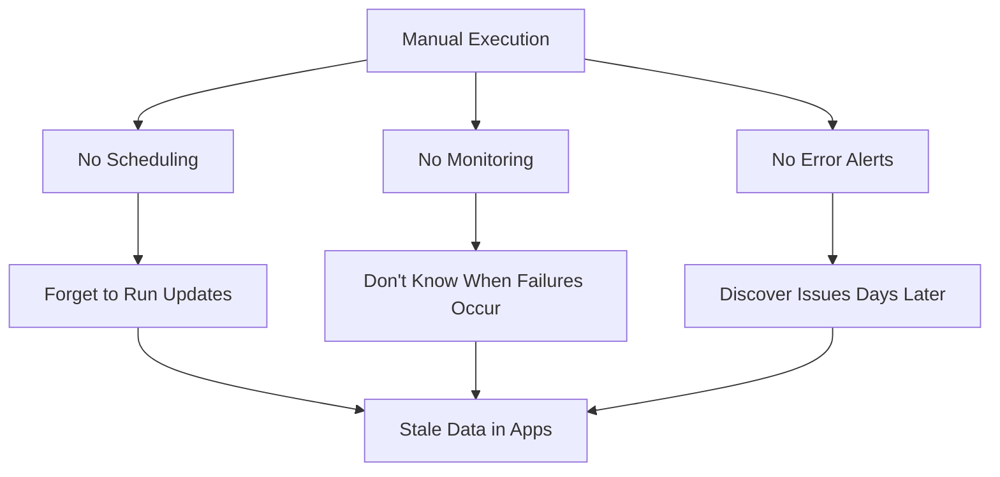
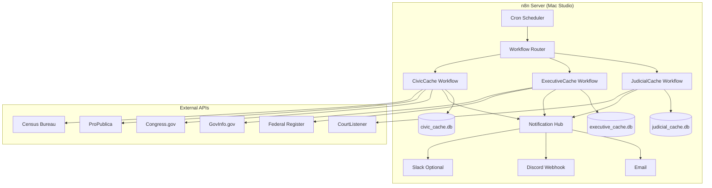
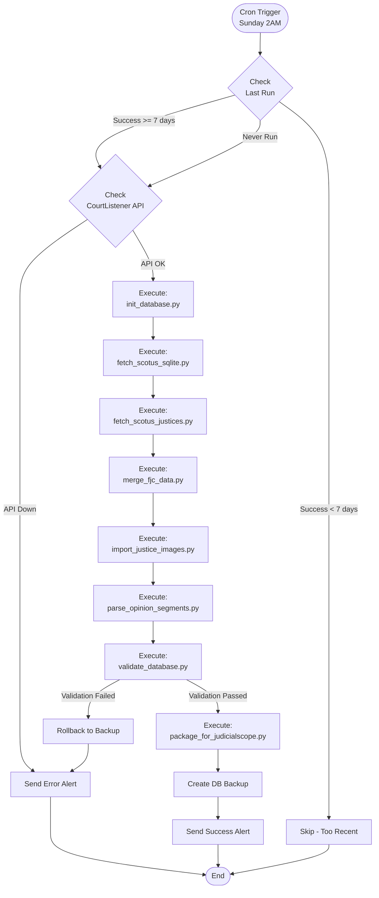
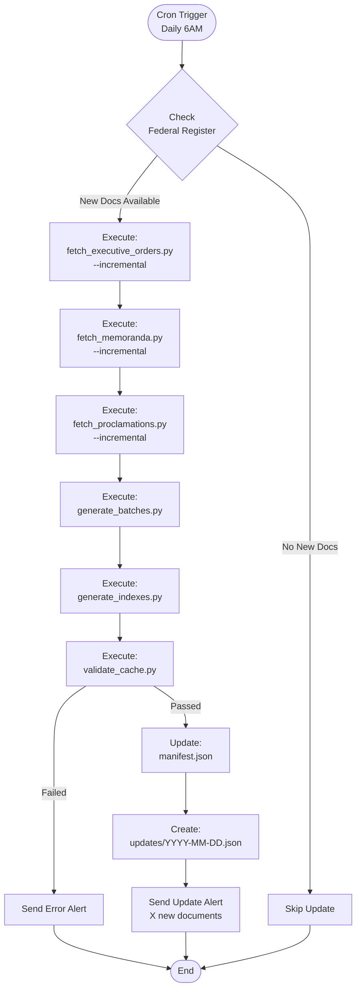
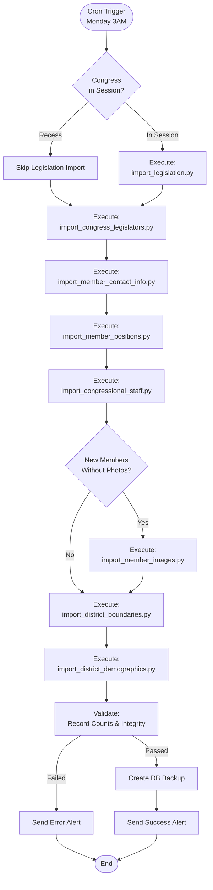
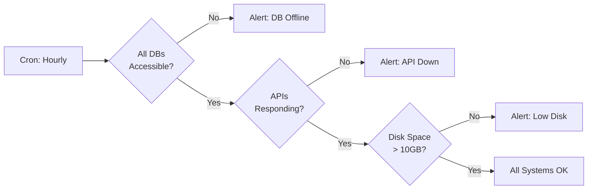

# n8n Automation Plan for Cache Apps

**Date Created**: 2025-12-26
**Status**: Proposed
**Scope**: JudicialCache, ExecutiveCache, CivicCache

---

## Executive Summary

This document proposes using **[n8n](https://n8n.io/)** (Fair Code workflow automation platform) to orchestrate the data pipeline for all three Cache applications. n8n would replace manual script execution with automated workflows that run on schedules, handle errors, send notifications, and manage state across all data sources.

**Goal**: Transform 40+ independent Python scripts across 3 projects into automated, monitored, self-healing data pipelines.

---

## Table of Contents

1. [What is n8n?](#what-is-n8n)
2. [Current Architecture](#current-architecture)
3. [Proposed n8n Architecture](#proposed-n8n-architecture)
4. [Workflow Designs](#workflow-designs)
5. [Implementation Plan](#implementation-plan)
6. [Pros and Cons Analysis](#pros-and-cons-analysis)
7. [Alternative Approaches](#alternative-approaches)
8. [Cost Analysis](#cost-analysis)
9. [Recommendations](#recommendations)

---

## What is n8n?

[n8n](https://n8n.io/) is a **fair-code licensed workflow automation platform** (Apache 2.0 with Commons Clause) that lets you automate complex multi-step processes using a visual interface.

### Key Features for Our Use Case

- **Visual Workflow Builder**: Drag-and-drop nodes for HTTP requests, Python execution, file operations
- **400+ Pre-built Integrations**: GitHub, PostgreSQL, SQLite, HTTP, FTP, Email, Slack, Discord
- **Python Code Execution**: Run Python scripts directly in workflows via Execute Command or Function nodes
- **Scheduling**: Cron-based scheduling for periodic data fetches
- **Error Handling**: Retry logic, fallback paths, error notifications
- **State Management**: Store progress, track last successful run
- **Self-Hosted**: Run on Mac Studio, Raspberry Pi, or cloud server
- **API Access**: REST API for programmatic workflow triggers
- **Webhook Support**: Trigger workflows via HTTP webhooks
- **Database Connectors**: Direct SQLite/PostgreSQL integration

### Deployment Options

1. **Desktop App** (macOS): Runs locally on Mac Studio
2. **Docker Container**: `docker run -p 5678:5678 n8nio/n8n`
3. **Cloud Hosted**: n8n Cloud (paid service)
4. **npm Package**: `npm install n8n -g && n8n start`

---

## Current Architecture

### Script Inventory Across Projects

| Project | Script Count | Main Data Sources | Update Frequency |
|---------|-------------|-------------------|------------------|
| **JudicialCache** | 17 scripts | CourtListener API, Harvard CAP, FJC | Weekly |
| **ExecutiveCache** | 12+ scripts | Federal Register API, GovInfo API | Daily |
| **CivicCache** | 20+ scripts | Congress.gov API, ProPublica, FEC, Census | Weekly |
| **Total** | **49+ scripts** | **7+ APIs** | **Mixed** |

### Current Pain Points



**Problems**:
1. **Manual execution**: Must remember to run scripts weekly
2. **No failure notifications**: Silent failures go unnoticed
3. **No progress visibility**: Can't see pipeline status
4. **Difficult coordination**: Managing 49 scripts across 3 projects
5. **No rollback**: Failed imports corrupt databases
6. **Rate limit issues**: APIs get throttled without coordination

---

## Proposed n8n Architecture

### High-Level Design



### n8n Workflow Organization

```
n8n Workflows/
├── 📅 Schedulers/
│   ├── Daily Update Dispatcher
│   ├── Weekly Update Dispatcher
│   └── Monthly Update Dispatcher
│
├── 🏛️ JudicialCache/
│   ├── 01_Initialize_Database
│   ├── 02_Fetch_Opinions
│   ├── 03_Fetch_Justices
│   ├── 04_Merge_FJC_Data
│   ├── 05_Fetch_Photos
│   ├── 06_Parse_Segments
│   ├── 07_Validate_Database
│   └── 08_Package_for_iOS
│
├── 🏢 ExecutiveCache/
│   ├── 01_Fetch_Executive_Orders
│   ├── 02_Fetch_Memoranda
│   ├── 03_Fetch_Proclamations
│   ├── 04_Generate_Batches
│   ├── 05_Generate_Indexes
│   └── 06_Validate_Cache
│
├── 🏛️ CivicCache/
│   ├── 01_Import_Legislators
│   ├── 02_Import_Legislation
│   ├── 03_Import_District_Data
│   ├── 04_Import_Demographics
│   ├── 05_Import_FEC_Committees
│   ├── 06_Import_Congressional_Staff
│   └── 07_Import_Member_Photos
│
└── 🔧 Utilities/
    ├── Health_Check_All_Databases
    ├── API_Rate_Limit_Monitor
    ├── Disk_Space_Monitor
    └── Backup_All_Databases
```

---

## Workflow Designs

### Example 1: JudicialCache Weekly Update



**n8n Node Breakdown**:
1. **Cron Trigger**: Runs every Sunday at 2 AM
2. **Function Node**: Load pipeline state from JSON
3. **If Node**: Check if update needed
4. **HTTP Request**: Test CourtListener API health
5. **Execute Command Nodes**: Run each Python script sequentially
6. **SQLite Nodes**: Validate record counts
7. **Discord/Email Nodes**: Send notifications
8. **Set Node**: Update pipeline state

### Example 2: ExecutiveCache Daily Update



**Special Features**:
- Checks Federal Register for new documents before running
- Creates incremental update files for efficient app imports
- Updates manifest with latest statistics
- Sends detailed notification with document counts

### Example 3: CivicCache Weekly Update



**Smart Features**:
- Checks congressional calendar before importing legislation
- Conditional photo import (only for new members)
- Validates foreign key relationships
- Creates timestamped backups before major changes

---

## Implementation Plan

### Phase 1: n8n Setup (Week 1)

**Tasks**:
- [ ] Install n8n on Mac Studio via Docker
- [ ] Configure persistent storage for workflows
- [ ] Set up secure API key storage (environment variables)
- [ ] Configure email/Discord notifications
- [ ] Create backup strategy for n8n workflows

**Docker Compose Setup**:
```yaml
version: '3.8'

services:
  n8n:
    image: n8nio/n8n
    container_name: n8n
    restart: unless-stopped
    ports:
      - "5678:5678"
    environment:
      - N8N_BASIC_AUTH_ACTIVE=true
      - N8N_BASIC_AUTH_USER=admin
      - N8N_BASIC_AUTH_PASSWORD=${N8N_PASSWORD}
      - N8N_HOST=localhost
      - N8N_PORT=5678
      - N8N_PROTOCOL=http
      - WEBHOOK_URL=http://localhost:5678/
      - GENERIC_TIMEZONE=America/Los_Angeles
    volumes:
      - n8n_data:/home/node/.n8n
      - /Users/abrooks/GIT:/git:ro  # Read-only access to scripts
      - /Users/abrooks/GIT/JudicialCache/data:/data/judicial
      - /Users/abrooks/GIT/ExecutiveCache/data:/data/executive
      - /Users/abrooks/GIT/CivicCache/data:/data/civic

volumes:
  n8n_data:
```

### Phase 2: Refactor Scripts for n8n (Week 2-3)

**Standardize All Scripts**:

Each script needs:
1. **Exit codes**: `0` for success, `1-255` for errors
2. **JSON output**: Structured results to stdout
3. **Progress updates**: Optional `--progress-file` argument
4. **Dry-run mode**: `--dry-run` for testing
5. **Idempotency**: Safe to re-run without corruption

**Example Refactoring**:

```python
#!/usr/bin/env python3
"""
JudicialCache Opinion Fetcher - n8n Compatible
Outputs JSON to stdout for n8n consumption
"""
import sys
import json
from pathlib import Path

def main():
    try:
        # Your existing logic here
        opinions_fetched = fetch_opinions()

        # Output structured JSON for n8n
        result = {
            "success": True,
            "opinions_fetched": opinions_fetched,
            "database_path": str(DB_PATH),
            "timestamp": datetime.now().isoformat()
        }
        print(json.dumps(result))
        return 0

    except Exception as e:
        error = {
            "success": False,
            "error": str(e),
            "timestamp": datetime.now().isoformat()
        }
        print(json.dumps(error), file=sys.stderr)
        return 1

if __name__ == '__main__':
    sys.exit(main())
```

### Phase 3: Build Core Workflows (Week 4-5)

**Priority Order**:
1. ✅ JudicialCache weekly update (simplest, well-defined)
2. ✅ ExecutiveCache daily update (medium complexity)
3. ✅ CivicCache weekly update (most complex)
4. ✅ Health check & monitoring workflows
5. ✅ Backup & rollback workflows

**Per-Workflow Tasks**:
- [ ] Create workflow in n8n UI
- [ ] Add all execution nodes
- [ ] Configure error handling
- [ ] Add retry logic for API calls
- [ ] Set up notifications
- [ ] Test dry-run mode
- [ ] Test actual execution
- [ ] Document workflow

### Phase 4: Monitoring & Alerts (Week 6)

**Health Check Workflow** (runs hourly):


**Notification Channels**:
- **Discord**: Immediate alerts to dedicated channel
- **Email**: Daily summary reports
- **n8n Dashboard**: Real-time workflow status

### Phase 5: Documentation & Handoff (Week 7)

**Deliverables**:
- [ ] Workflow export files (.json)
- [ ] Setup documentation
- [ ] Troubleshooting guide
- [ ] Runbook for common issues
- [ ] Backup/restore procedures
- [ ] Migration guide from manual execution

---

## Pros and Cons Analysis

### Pros of n8n Automation

| Benefit | Impact | Example |
|---------|--------|---------|
| **Visual Monitoring** | High | See all pipelines status at a glance |
| **Automatic Scheduling** | High | No more forgetting weekly updates |
| **Error Notifications** | High | Know immediately when failures occur |
| **Centralized Management** | High | One place to manage 49 scripts |
| **Built-in Retry Logic** | Medium | Handle transient API failures automatically |
| **State Management** | Medium | Track last successful run, resume from checkpoints |
| **Version Control** | Medium | Export workflows as JSON, commit to Git |
| **Webhook Triggers** | Medium | Trigger workflows from external events |
| **No Code Changes** | Low | Scripts run as-is via Execute Command nodes |
| **Easy Testing** | Medium | Test individual nodes, dry-run workflows |
| **Audit Trail** | Medium | See execution history, debug failures |
| **Parallel Execution** | Low | Run independent tasks concurrently |

### Cons of n8n Automation

| Challenge | Severity | Mitigation Strategy |
|-----------|----------|---------------------|
| **Learning Curve** | Medium | n8n UI is intuitive, but workflow design takes practice |
| **Single Point of Failure** | High | If n8n crashes, all automation stops → Use Docker auto-restart |
| **Resource Usage** | Low | n8n Docker container uses ~200-300MB RAM |
| **Workflow Complexity** | Medium | Large workflows become hard to visualize → Break into sub-workflows |
| **Limited Python Integration** | Medium | No native Python node → Use Execute Command or HTTP Request to Python API |
| **Debugging Difficulty** | Medium | Harder to debug than running scripts directly → Use extensive logging |
| **Vendor Lock-in** | Low | Workflows are JSON, scripts unchanged → Easy to migrate away |
| **Initial Setup Time** | Medium | 6-7 weeks to implement fully → Incremental deployment possible |
| **API Rate Limit Coordination** | Medium | Multiple workflows hitting same API → Implement rate limit tracking |
| **Database Lock Issues** | Medium | Concurrent writes to SQLite → Serialize database writes |

### Risk Assessment

| Risk | Probability | Impact | Mitigation |
|------|------------|--------|------------|
| n8n server crashes | Low | High | Docker auto-restart + monitoring |
| Workflow fails silently | Low | High | Mandatory error notifications |
| Database corruption | Low | Critical | Pre-run backups + validation |
| API key exposure | Medium | High | Use environment variables, never hardcode |
| Disk fills up | Low | Medium | Disk space monitoring workflow |
| Script changes break workflows | Medium | Medium | Version workflows with scripts |
| Forgetting to update n8n | Low | Low | n8n auto-updates in Docker |

---

## Alternative Approaches

### Option 1: GitHub Actions (CI/CD)

**Pros**:
- Free for public repos
- Native Git integration
- Familiar YAML syntax
- Excellent for scheduled jobs

**Cons**:
- No visual interface
- Limited to 6 hours per job
- Harder to debug
- No state management without artifacts
- Requires cloud runners or self-hosted

**Verdict**: Good for lightweight automation, but lacks n8n's flexibility and monitoring.

### Option 2: Apache Airflow

**Pros**:
- Industry standard for data pipelines
- Python-native (DAGs written in Python)
- Powerful scheduling
- Great monitoring UI

**Cons**:
- Complex setup (PostgreSQL required)
- Steeper learning curve
- Overkill for our use case
- Resource-heavy

**Verdict**: Too complex for our relatively simple pipelines.

### Option 3: Cron + Bash Scripts

**Pros**:
- Simple, no new tools
- Built into macOS
- Zero resource overhead

**Cons**:
- No monitoring UI
- No error notifications
- Hard to manage dependencies
- No state tracking
- Difficult to debug

**Verdict**: Current state - what we're trying to improve.

### Option 4: Python Orchestrator (Custom)

**Pros**:
- Complete control
- Python-native
- Can implement exactly what we need

**Cons**:
- Development time (estimated 30-40 hours)
- Ongoing maintenance burden
- No UI
- Reinventing the wheel

**Verdict**: Viable but time-consuming. See JudicialCache's PIPELINE_REFACTORING_PLAN.md for this approach.

### Comparison Matrix

| Feature | n8n | GitHub Actions | Airflow | Cron | Custom Python |
|---------|-----|----------------|---------|------|---------------|
| Visual UI | ✅ Excellent | ❌ None | ✅ Good | ❌ None | ❌ None |
| Setup Time | 🟡 1-2 weeks | 🟢 1-2 days | 🔴 2-3 weeks | 🟢 1 hour | 🟡 4-5 weeks |
| Monitoring | ✅ Built-in | 🟡 Basic | ✅ Excellent | ❌ Manual | 🟡 DIY |
| Notifications | ✅ Multi-channel | 🟡 Email only | ✅ Multi-channel | ❌ Manual | 🟡 DIY |
| Error Handling | ✅ Built-in | 🟡 Basic | ✅ Excellent | ❌ Manual | 🟡 DIY |
| State Management | ✅ Built-in | 🟡 Artifacts | ✅ Database | ❌ Files | 🟡 DIY |
| Resource Usage | 🟡 Low-Medium | 🟢 None (cloud) | 🔴 High | 🟢 Minimal | 🟢 Minimal |
| Python Integration | 🟡 Via Execute | 🟢 Native | 🟢 Native | 🟢 Direct | 🟢 Native |
| Learning Curve | 🟡 Medium | 🟢 Low | 🔴 High | 🟢 Low | 🟡 Medium |
| Flexibility | ✅ High | 🟡 Medium | ✅ Very High | 🟡 Medium | ✅ Complete |
| Cost | 🟢 Free (self-hosted) | 🟢 Free (public) | 🟢 Free (self-hosted) | 🟢 Free | 🟢 Free |

---

## Cost Analysis

### n8n Self-Hosted (Recommended)

**Setup Costs**:
- Development time: 6-7 weeks (120-140 hours) @ $0/hour (your time)
- Server costs: $0 (using existing Mac Studio)
- Storage: $0 (using existing disks)
- **Total**: $0 cash, significant time investment

**Ongoing Costs**:
- Electricity: ~5-10W for Docker container ≈ $0.50/month
- Maintenance: ~2-4 hours/month (monitoring, updates)
- **Total**: Minimal

### n8n Cloud (Alternative)

**Pricing** (as of Dec 2025):
- Starter: $20/month (5,000 workflow executions)
- Pro: $50/month (50,000 executions)
- **Estimate**: $20-50/month

**Not recommended** because:
- We have Mac Studio running 24/7 anyway
- Self-hosted is free
- More control over data/security

### Time Investment Comparison

| Approach | Initial Setup | Monthly Maintenance | First Year Total |
|----------|--------------|---------------------|------------------|
| **n8n** | 120-140 hours | 2-4 hours | 168-188 hours |
| **GitHub Actions** | 40-60 hours | 4-6 hours | 88-132 hours |
| **Custom Python** | 160-200 hours | 3-5 hours | 196-260 hours |
| **Manual (current)** | 0 hours | 15-20 hours | 180-240 hours |

**ROI Analysis**:
- n8n pays for itself after 10-12 months (vs manual)
- Prevents data staleness issues
- Catches failures immediately
- Reduces stress of manual maintenance

---

## Recommendations

### Primary Recommendation: Hybrid Approach

```
Phase 1 (Months 1-2): Python Pipeline Refactoring
├── Implement JudicialCache unified pipeline (build_judicial_cache.py)
├── Implement ExecutiveCache unified pipeline (build_executive_cache.py)
├── Implement CivicCache unified pipeline (build_civic_cache.py)
└── Test each pipeline independently

Phase 2 (Months 3-4): n8n Orchestration
├── Install n8n on Mac Studio
├── Create workflows that call unified pipelines
├── Add monitoring and notifications
├── Test scheduling and error handling
└── Gradually migrate from manual to automated execution

Phase 3 (Month 5): Monitoring & Optimization
├── Set up health check workflows
├── Implement backup strategies
├── Fine-tune schedules based on API patterns
├── Create dashboards and reports
└── Document everything
```

**Rationale**:
1. **Python pipelines first** = Independent scripts become testable units
2. **n8n orchestration second** = Adds scheduling, monitoring, notifications
3. **Best of both worlds** = Python control + n8n automation

### Alternative: n8n Only (Faster but Less Maintainable)

If time is critical, skip pipeline refactoring and jump straight to n8n:
- Create workflows that execute existing scripts directly
- Add minimal JSON output to scripts
- **Pros**: Faster implementation (4-5 weeks total)
- **Cons**: Scripts remain fragmented, harder to test

### Minimal Viable Automation (Cron + Scripts)

If n8n seems too complex:
1. Add JSON output to all scripts
2. Create simple Bash orchestrator scripts
3. Use cron for scheduling
4. Send errors to Discord webhook
5. **Pros**: Simple, quick (2-3 weeks)
6. **Cons**: No UI, minimal monitoring

---

## Next Steps

### Immediate Actions (This Week)

- [ ] Review this document and decide on approach
- [ ] If proceeding with n8n: Install Docker and n8n on Mac Studio
- [ ] Test n8n with one simple workflow (e.g., "Hello World" HTTP request)
- [ ] Identify one script to refactor as proof-of-concept

### Week 2-3: Proof of Concept

- [ ] Refactor 1 script from each project to output JSON
- [ ] Create 3 basic n8n workflows
- [ ] Test scheduling, execution, error handling
- [ ] Evaluate if approach is viable

### Decision Point (End of Week 3)

**Go/No-Go Decision**:
- ✅ Continue with full implementation if POC successful
- 🔄 Adjust approach based on learnings
- ❌ Fall back to manual execution if too complex

---

## Conclusion

**n8n automation offers significant benefits for managing the Cache app data pipelines**:

✅ **Pros Outweigh Cons**:
- Eliminates manual scheduling
- Immediate failure notifications
- Visual monitoring dashboard
- Centralized management
- Minimal ongoing cost

⚠️ **Challenges Are Manageable**:
- Initial 6-7 week investment
- Learning curve is moderate
- Risk mitigation strategies exist

🎯 **Recommended Path**:
1. Start with Python pipeline consolidation (as per PIPELINE_REFACTORING_PLAN.md)
2. Layer n8n on top for orchestration and monitoring
3. Implement incrementally (one project at a time)
4. Maintain ability to run scripts manually as fallback

**Expected Outcome**: Reliable, automated data pipelines that require minimal manual intervention, with immediate visibility into failures and comprehensive monitoring.

---

**Document Version**: 1.0
**Last Updated**: 2025-12-26
**Author**: Claude (based on JudicialCache PIPELINE_REFACTORING_PLAN.md)
**Related Docs**:
- JudicialCache: `docs/PIPELINE_REFACTORING_PLAN.md`
- ExecutiveCache: `docs/OPTIMIZED_CACHE_STRUCTURE.md`
- CivicCache: `docs/congressional_staff_table_plan.md`
