# Complete n8n Cache Automation Workflow Guide

**Date**: 2025-12-27
**Workflow**: Unified Cache Automation (All 3 Projects)
**File**: `cache_automation_workflow.json`

---

## Table of Contents

1. [Understanding the Question Marks](#understanding-the-question-marks)
2. [Complete Workflow Architecture](#complete-workflow-architecture)
3. [Detailed Connection Map](#detailed-connection-map)
4. [Setup Checklist](#setup-checklist)
5. [Testing Checklist](#testing-checklist)
6. [Troubleshooting](#troubleshooting)

---

## Understanding the Question Marks

### Why All the "?" Icons in the Screenshot?

The question marks (`?`) you see in the n8n screenshot indicate **Execute Command nodes that haven't been configured yet**. This is normal for imported workflows.

**What they mean**:
- ❓ = Execute Command node with a command defined, but n8n shows `?` until the node is opened/saved
- These are NOT errors - they're just unconfigured visual indicators
- The commands ARE present in the JSON - they just need to be "activated" by opening each node

**How to fix**:
1. Click on each `?` node
2. Review the command (it's already filled in from the JSON)
3. Click "Execute Node" or just close the panel
4. The `?` will change to a checkmark ✓ or the node name

**Why this happens**:
- n8n doesn't fully render Execute Command nodes until they're opened at least once
- This is a visual quirk of n8n's import process
- All the commands and connections are already configured in the JSON

---

## Complete Workflow Architecture

### High-Level Overview

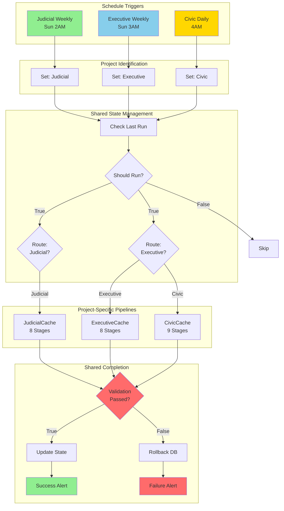

---

## Detailed Connection Map

### Complete Node-by-Node Workflow

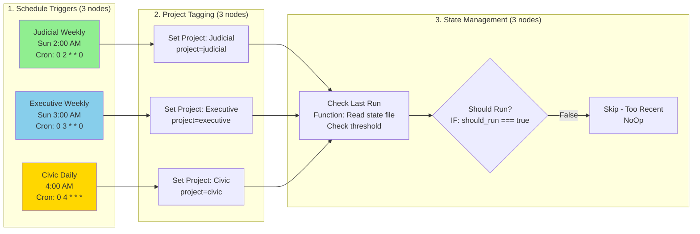

### Routing Logic

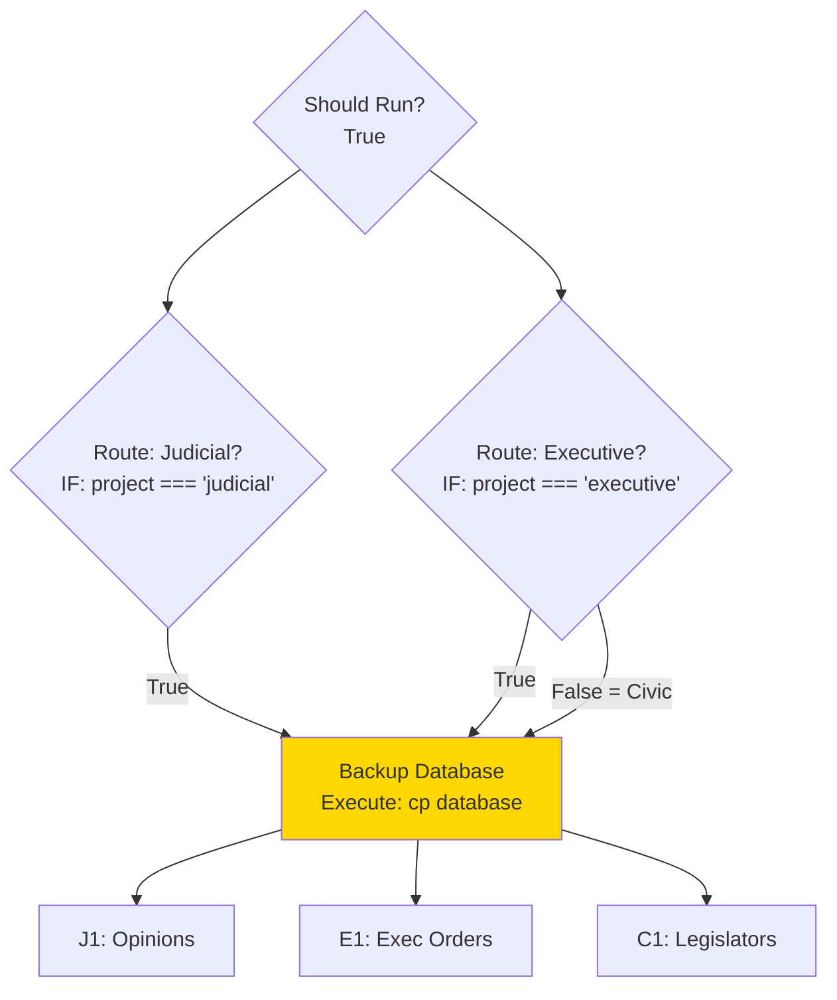

---

### JudicialCache Pipeline (8 Stages)

```mermaid
graph LR
    BACKUP[Backup Database] --> J1

    J1[J1: Opinions<br/>fetch_scotus_sqlite.py<br/>--incremental<br/>1-2 min] --> J2

    J2[J2: Justices<br/>fetch_scotus_justices.py<br/>--incremental<br/>30 sec] --> J3

    J3[J3: Photos<br/>import_justice_images.py<br/>--new-only<br/>1-2 min] --> J4

    J4[J4: Presidents<br/>update_appointing_presidents.py<br/>--new-only<br/>10 sec] --> J5

    J5[J5: Segments<br/>parse_opinion_segments.py<br/>--incremental<br/>1-2 min] --> J6

    J6[J6: Validate<br/>Check: 100K+ opinions<br/>100+ justices<br/>2-5 sec] --> J7

    J7[J7: Package<br/>package_for_judicialscope.py<br/>VACUUM/ANALYZE<br/>5-10 sec] --> VALIDATE

    VALIDATE{Validation Passed?}

    style J1 fill:#90EE90
    style J3 fill:#FFB6C1
    style J4 fill:#FFB6C1
    style J6 fill:#FFD700
    style VALIDATE fill:#FF6B6B
```

**Total Runtime**: 5-15 minutes

---

### ExecutiveCache Pipeline (8 Stages)

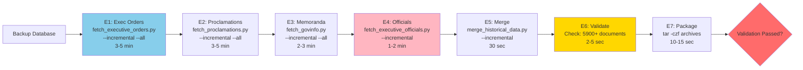

**Total Runtime**: 10-20 minutes

---

### CivicCache Pipeline (9 Stages)

```mermaid
graph LR
    BACKUP[Backup Database] --> C1

    C1[C1: Legislators<br/>import_congress_legislators.py<br/>30 sec] --> C2

    C2[C2: Contact Info<br/>import_member_contact_info.py<br/>--new-only<br/>30 sec] --> C3

    C3[C3: Images<br/>import_member_images.py<br/>--new-only<br/>1-2 min] --> C4

    C4[C4: Metadata<br/>import_member_positions.py<br/>--incremental<br/>1-2 min] --> C5

    C5[C5: Legislation<br/>import_legislation.py<br/>--congress 119 --incremental<br/>5-10 min] --> C6

    C6[C6: Committees<br/>import_fec_committees.py<br/>--incremental<br/>2-3 min] --> C7

    C7[C7: Validate<br/>Check: 535+ members<br/>10K+ bills<br/>2-5 sec] --> C8

    C8[C8: Package<br/>VACUUM; ANALYZE<br/>5-10 sec] --> VALIDATE

    VALIDATE{Validation Passed?}

    style C1 fill:#FFD700
    style C2 fill:#FFB6C1
    style C3 fill:#FFB6C1
    style C7 fill:#FFD700
    style VALIDATE fill:#FF6B6B
```

**Total Runtime**: 10-25 minutes

---

### Completion & Notification Flow

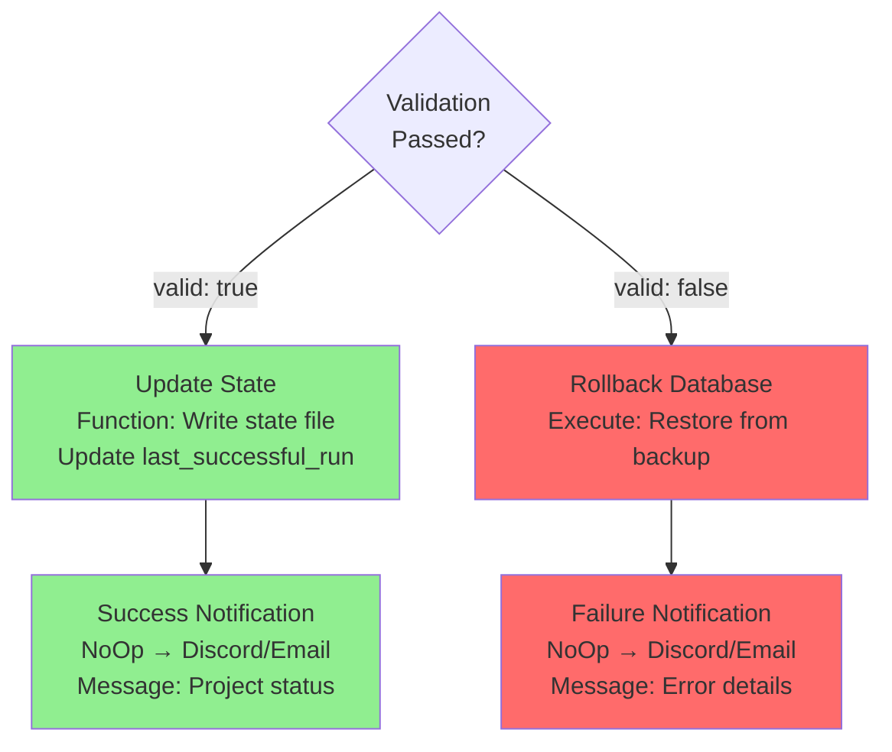

---

## Complete Node Connection Table

| From Node | To Node | Connection Type | Condition |
|-----------|---------|----------------|-----------|
| **Triggers → Project Setup** |
| Judicial Weekly (Sun 2AM) | Set Project: Judicial | Main | Always |
| Executive Weekly (Sun 3AM) | Set Project: Executive | Main | Always |
| Civic Daily (4AM) | Set Project: Civic | Main | Always |
| **Project Setup → State Check** |
| Set Project: Judicial | Check Last Run | Main | Always |
| Set Project: Executive | Check Last Run | Main | Always |
| Set Project: Civic | Check Last Run | Main | Always |
| **State Check → Routing** |
| Check Last Run | Should Run? | Main | Always |
| Should Run? | Route: Judicial? | Main (True) | `should_run === true` |
| Should Run? | Route: Executive? | Main (True) | `should_run === true` |
| Should Run? | Skip - Too Recent | Main (False) | `should_run === false` |
| **Routing → Backup** |
| Route: Judicial? | Backup Database | Main (True) | `project === 'judicial'` |
| Route: Executive? | Backup Database | Main (True) | `project === 'executive'` |
| Route: Executive? | Backup Database | Main (False) | `project === 'civic'` |
| **Backup → Pipelines** |
| Backup Database | J1: Opinions | Main | If Judicial |
| Backup Database | E1: Exec Orders | Main | If Executive |
| Backup Database | C1: Legislators | Main | If Civic |
| **Judicial Pipeline Chain** |
| J1: Opinions | J2: Justices | Main | Always |
| J2: Justices | J3: Photos | Main | Always |
| J3: Photos | J4: Presidents | Main | Always |
| J4: Presidents | J5: Segments | Main | Always |
| J5: Segments | J6: Validate | Main | Always |
| J6: Validate | J7: Package | Main | Always |
| J7: Package | Validation Passed? | Main | Always |
| **Executive Pipeline Chain** |
| E1: Exec Orders | E2: Proclamations | Main | Always |
| E2: Proclamations | E3: Memoranda | Main | Always |
| E3: Memoranda | E4: Officials | Main | Always |
| E4: Officials | E5: Merge | Main | Always |
| E5: Merge | E6: Validate | Main | Always |
| E6: Validate | E7: Package | Main | Always |
| E7: Package | Validation Passed? | Main | Always |
| **Civic Pipeline Chain** |
| C1: Legislators | C2: Contact Info | Main | Always |
| C2: Contact Info | C3: Images | Main | Always |
| C3: Images | C4: Metadata | Main | Always |
| C4: Metadata | C5: Legislation | Main | Always |
| C5: Legislation | C6: Committees | Main | Always |
| C6: Committees | C7: Validate | Main | Always |
| C7: Validate | C8: Package | Main | Always |
| C8: Package | Validation Passed? | Main | Always |
| **Completion Flow** |
| Validation Passed? | Update State | Main (True) | `valid === true` |
| Validation Passed? | Rollback Database | Main (False) | `valid === false` |
| Update State | Success Notification | Main | Always |
| Rollback Database | Failure Notification | Main | Always |

**Total Connections**: 50+ connections across 38 nodes

---

## Setup Checklist

### Pre-Import Requirements

#### 1. Docker & Environment Setup
```bash
# Verify Docker is running
docker ps | grep n8n

# Check volume mounts in docker-compose.yml
cat ~/n8n/docker-compose.yml | grep -A 5 volumes
```

**Required volumes**:
```yaml
volumes:
  - ./data:/home/node/.n8n
  - /Users/abrooks/GIT:/git:ro
  - ${JUDICIAL_DB}:/data/judicial
  - ${EXECUTIVE_DB}:/data/executive
  - ${CIVIC_DB}:/data/civic
```

#### 2. Environment Variables

Create/edit `.env` file in `~/n8n/`:

```bash
# Court APIs
COURTLISTENER_API_TOKEN=your_courtlistener_token_here

# Government APIs
GOVINFO_API_KEY=your_govinfo_key_here
CONGRESS_GOV_API_KEY=your_congress_gov_key_here
OPENFEC_API_KEY=your_openfec_key_here
CENSUS_API_KEY=your_census_key_here

# Database paths (host paths)
JUDICIAL_DB=/Users/abrooks/GIT/JudicialCache/data
EXECUTIVE_DB=/Users/abrooks/GIT/ExecutiveCache/data
CIVIC_DB=/Users/abrooks/GIT/CivicCache/data
```

**Restart n8n** after updating `.env`:
```bash
cd ~/n8n
docker-compose down
docker-compose up -d
```

#### 3. Database Verification

**Check all three databases exist**:

```bash
# JudicialCache
ls -lh /Users/abrooks/GIT/JudicialCache/data/judicial_cache.db
# Expected: ~50-100 MB file

# ExecutiveCache
ls -lh /Users/abrooks/GIT/ExecutiveCache/data/executive_cache.db
# Expected: ~2-5 MB file

# CivicCache
ls -lh /Users/abrooks/GIT/CivicCache/data/civic_cache.db
# Expected: ~15-20 MB file
```

**If any database is missing**, run full rebuild (see Full Rebuild section below).

---

### Import Workflow

#### 4. Import JSON File

1. Open n8n: http://localhost:5678
2. Click **"Workflows"** in left sidebar
3. Click **"+ Add workflow"** (top right)
4. Click **"⋯"** menu (top right) → **"Import from File"**
5. Navigate to: `/Users/abrooks/GIT/CivicCache/cache_automation_workflow.json`
6. Click **"Import"**
7. Wait for workflow to load (38 nodes should appear)

#### 5. Fix the Question Marks

The `?` icons mean Execute Command nodes need to be "activated":

**Quick fix (do for ALL nodes with `?`)**:
1. Click on node with `?`
2. Panel opens showing the command (already filled in)
3. Click **"Execute Node"** once (or just close panel)
4. `?` changes to node name
5. Repeat for all 25 Execute Command nodes

**Faster method**:
- Click **"Save"** workflow (even without changes)
- n8n will validate all nodes
- Most `?` icons will resolve automatically

---

### Configure Notifications (Optional but Recommended)

#### 6. Replace NoOp Notification Nodes

**Success Notification:**
1. Delete "Success Notification" NoOp node
2. Add new node: Click **"+"** → Search "Discord" or "Send Email"
3. Configure credentials:
   - **Discord**: Webhook URL
   - **Email**: SMTP settings
4. Set message template:
   ```
   ✅ {{ $json.project.toUpperCase() }}Cache Update Success

   Project: {{ $json.project }}
   Time: {{ $now.toISO() }}
   Duration: {{ $workflow.duration }} seconds
   Mode: Incremental (delta only)
   ```
5. Connect "Update State" → new notification node

**Failure Notification:**
1. Delete "Failure Notification" NoOp node
2. Add new node: Discord or Email
3. Configure same credentials
4. Set message template:
   ```
   🚨 {{ $json.project.toUpperCase() }}Cache Update Failed

   Project: {{ $json.project }}
   Error: {{ $json.error || 'Unknown error' }}
   Rollback: {{ $json.rollback ? 'Success' : 'Failed' }}
   Action: Check n8n logs and database
   ```
5. Connect "Rollback Database" → new notification node

---

## Testing Checklist

### Individual Project Tests

#### Test 1: JudicialCache Pipeline

```mermaid
graph LR
    START[Right-click<br/>Judicial Weekly] --> EXECUTE[Execute Node]
    EXECUTE --> WATCH[Watch Execution]
    WATCH --> J1[J1: Opinions<br/>✓]
    J1 --> J2[J2: Justices<br/>✓]
    J2 --> J3[J3: Photos<br/>✓]
    J3 --> J4[J4: Presidents<br/>✓]
    J4 --> J5[J5: Segments<br/>✓]
    J5 --> J6[J6: Validate<br/>✓]
    J6 --> J7[J7: Package<br/>✓]
    J7 --> SUCCESS[Success<br/>Notification]

    style START fill:#90EE90
    style SUCCESS fill:#90EE90
```

**Steps**:
1. Right-click "Judicial Weekly (Sun 2AM)" node
2. Select **"Execute Node"**
3. Watch execution progress (live in UI)
4. Verify each J1-J7 node completes (green checkmark)
5. Check "Success Notification" receives data

**Expected Output**:
```json
{
  "valid": true,
  "project": "judicial",
  "opinions": 312000,
  "justices": 116,
  "segments": 503000
}
```

**Verify State File**:
```bash
cat /Users/abrooks/GIT/JudicialCache/data/pipeline_state.json | jq
```

Expected:
```json
{
  "last_successful_run": "2025-12-27T18:30:00.000Z",
  "version": "1.0",
  "workflow_id": "...",
  "execution_id": "...",
  "project": "judicial"
}
```

**Pass Criteria**:
- ✅ All 8 stages complete without errors
- ✅ Validation returns `"valid": true`
- ✅ State file updated with current timestamp
- ✅ Duration: 5-15 minutes

---

#### Test 2: ExecutiveCache Pipeline

**Steps**:
1. Right-click "Executive Weekly (Sun 3AM)" node
2. Select **"Execute Node"**
3. Watch E1-E7 nodes execute sequentially
4. Verify "Success Notification" triggers

**Expected Output**:
```json
{
  "valid": true,
  "project": "executive",
  "total": 5970
}
```

**Pass Criteria**:
- ✅ All 8 stages complete
- ✅ Archives created: `ls -lh /Users/abrooks/GIT/ExecutiveCache/data/*_seed.tar.gz`
- ✅ Duration: 10-20 minutes

---

#### Test 3: CivicCache Pipeline

**Steps**:
1. Right-click "Civic Daily (4AM)" node
2. Select **"Execute Node"**
3. Watch C1-C8 nodes execute sequentially
4. Verify "Success Notification" triggers

**Expected Output**:
```json
{
  "valid": true,
  "project": "civic",
  "members": 537,
  "legislation": 15000
}
```

**Pass Criteria**:
- ✅ All 9 stages complete
- ✅ Database optimized (VACUUM/ANALYZE)
- ✅ Duration: 10-25 minutes

---

### State Management Tests

#### Test 4: "Skip - Too Recent" Logic

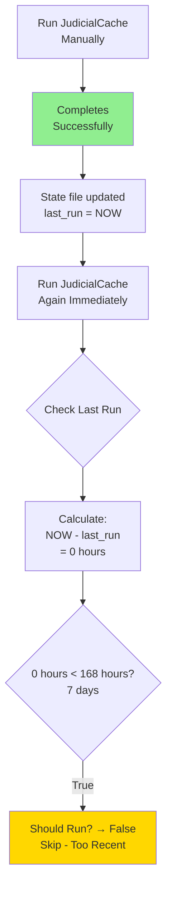

**Steps**:
1. Run JudicialCache manually → completes successfully
2. **Immediately** run JudicialCache again
3. Observe execution flow

**Expected Behavior**:
- First run: Executes all 8 stages
- Second run: Stops at "Should Run?" → "Skip - Too Recent"
- No pipeline stages execute
- State file unchanged

**Verify**:
```bash
# Check state file wasn't updated on second run
cat /data/judicial/pipeline_state.json | jq '.last_successful_run'
# Should match first run timestamp
```

**Pass Criteria**:
- ✅ Second run skips pipeline entirely
- ✅ Execution time < 5 seconds (just checks state)
- ✅ No database changes on second run

---

### Validation & Rollback Tests

#### Test 5: Validation Failure & Rollback

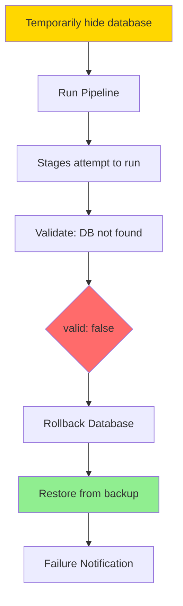

**Test with JudicialCache**:

```bash
# 1. Backup the database (safety)
cp /Users/abrooks/GIT/JudicialCache/data/judicial_cache.db \
   /Users/abrooks/GIT/JudicialCache/data/judicial_cache.db.safe

# 2. Temporarily hide database
mv /Users/abrooks/GIT/JudicialCache/data/judicial_cache.db \
   /Users/abrooks/GIT/JudicialCache/data/judicial_cache.db.hidden

# 3. Run JudicialCache pipeline in n8n
# (Right-click "Judicial Weekly" → Execute Node)

# 4. Watch execution - validation should fail
# Expected: "Validation Passed?" → False → "Rollback Database"

# 5. Restore database
mv /Users/abrooks/GIT/JudicialCache/data/judicial_cache.db.hidden \
   /Users/abrooks/GIT/JudicialCache/data/judicial_cache.db
```

**Expected Output from Validate Node**:
```json
{
  "valid": false,
  "error": "Database file not found - run full rebuild first"
}
```

**Expected Behavior**:
1. Validation fails at "J6: Validate"
2. Execution routes to "Rollback Database"
3. Rollback attempts to restore from backup
4. "Failure Notification" triggers

**Pass Criteria**:
- ✅ Validation correctly detects missing database
- ✅ Rollback node executes
- ✅ Failure notification sent
- ✅ State file NOT updated (still shows last successful run)

---

#### Test 6: Database Corruption & Recovery

**Test with CivicCache** (has smallest database):

```bash
# 1. Run CivicCache successfully first
# (Right-click "Civic Daily" → Execute Node)

# 2. Check records before corruption
sqlite3 /Users/abrooks/GIT/CivicCache/data/civic_cache.db \
  "SELECT COUNT(*) FROM congress_members;"
# Note the count (should be ~537)

# 3. Create a backup manually
cp /Users/abrooks/GIT/CivicCache/data/civic_cache.db \
   /Users/abrooks/GIT/CivicCache/data/civic_cache.db.manual_backup

# 4. Corrupt the database
echo "CORRUPTED DATA" >> /Users/abrooks/GIT/CivicCache/data/civic_cache.db

# 5. Run CivicCache pipeline
# (Right-click "Civic Daily" → Execute Node)

# 6. Watch execution - should fail at validation

# 7. Verify database was rolled back
sqlite3 /Users/abrooks/GIT/CivicCache/data/civic_cache.db \
  "SELECT COUNT(*) FROM congress_members;"
# Should match original count

# 8. Clean up
rm /Users/abrooks/GIT/CivicCache/data/civic_cache.db.manual_backup
```

**Expected Behavior**:
1. C7: Validate fails (SQLite error or wrong count)
2. Workflow routes to "Rollback Database"
3. Database restored from timestamped backup
4. Records verified intact after rollback

**Pass Criteria**:
- ✅ Corrupted database detected
- ✅ Rollback restores working database
- ✅ Record counts match pre-corruption state
- ✅ Failure notification sent with rollback status

---

### Scheduled Execution Tests

#### Test 7: Cron Trigger Verification

**Option A: Wait for Real Schedule** (recommended for production)

1. Activate workflow: Toggle "Active" switch (top right)
2. Wait for scheduled times:
   - Sunday 2:00 AM: JudicialCache
   - Sunday 3:00 AM: ExecutiveCache
   - Daily 4:00 AM: CivicCache
3. Check "Executions" tab next morning

**Option B: Test with Near-Future Time** (for immediate testing)

1. Edit "Judicial Weekly (Sun 2AM)" node
2. Change cron to 5 minutes from now:
   - If current time is 14:30, set: `35 14 * * *`
3. Save workflow and activate
4. Wait 5 minutes
5. Check if workflow auto-executes

**Verify Automatic Execution**:
```bash
# Check execution logs
cat /data/judicial/pipeline_state.json | jq '.last_successful_run'

# Should show a timestamp matching the cron schedule
```

**Pass Criteria**:
- ✅ Workflow executes automatically at scheduled time
- ✅ No manual trigger required
- ✅ Execution appears in "Executions" tab
- ✅ All three schedules work independently

---

## Troubleshooting Guide

### Common Issues & Solutions

#### Issue 1: Question Marks Don't Resolve

**Symptom**: After import, Execute Command nodes still show `?`

**Causes**:
- Nodes haven't been opened/validated yet
- JSON import incomplete

**Solutions**:
1. **Quick fix**: Click "Save" workflow (validates all nodes)
2. **Manual fix**: Click each `?` node, review command, close panel
3. **Re-import**: Delete workflow and import JSON again

**Verification**:
- All Execute Command nodes show descriptive names (not `?`)
- No red error indicators on nodes

---

#### Issue 2: "Database not found" Error

**Symptom**: Validation stage returns:
```json
{"valid": false, "error": "Database file not found - run full rebuild first"}
```

**Causes**:
- Database doesn't exist (never built)
- Wrong path in Docker volume mounts
- Database file permissions issue

**Solutions**:

1. **Check database exists**:
   ```bash
   # From host machine
   ls -lh /Users/abrooks/GIT/JudicialCache/data/judicial_cache.db

   # If missing, run full rebuild (see Full Rebuild section)
   ```

2. **Check Docker can access**:
   ```bash
   # Enter n8n container
   docker exec -it n8n /bin/sh

   # Check from inside container
   ls -lh /data/judicial/judicial_cache.db

   # If missing, check volume mounts in docker-compose.yml
   ```

3. **Fix permissions**:
   ```bash
   chmod 755 /Users/abrooks/GIT/JudicialCache/data
   chmod 644 /Users/abrooks/GIT/JudicialCache/data/judicial_cache.db
   ```

---

#### Issue 3: "API key not set" Error

**Symptom**: Execute Command fails with:
```
Environment variable COURTLISTENER_API_TOKEN not found
```

**Causes**:
- `.env` file missing or incomplete
- Docker container not restarted after `.env` update
- Typo in environment variable name

**Solutions**:

1. **Verify `.env` file exists**:
   ```bash
   cat ~/n8n/.env | grep COURTLISTENER_API_TOKEN
   ```

2. **Restart Docker container**:
   ```bash
   cd ~/n8n
   docker-compose down
   docker-compose up -d
   ```

3. **Verify from inside container**:
   ```bash
   docker exec -it n8n printenv | grep COURTLISTENER_API_TOKEN
   ```

4. **Check n8n can access**:
   - Settings → Environment
   - Should list all environment variables

---

#### Issue 4: Pipeline Stages Execute Out of Order

**Symptom**: Stages run simultaneously or skip stages

**Cause**: Connections between nodes are missing or incorrect

**Solution**:

**Re-verify connections** (see Connection Table above):
1. Click on each node
2. Check input/output connections in panel
3. Connections should be **sequential** (one at a time, not parallel)

**Fix missing connections**:
1. Hover over source node's right edge (green dot appears)
2. Drag to target node's left edge
3. Save workflow

---

#### Issue 5: Python Scripts Not Found

**Symptom**: Execute Command fails with:
```
python3: can't open file 'scripts/fetch_scotus_sqlite.py': No such file or directory
```

**Causes**:
- Volume mount incorrect
- Working directory wrong in commands
- Scripts don't have execute permissions

**Solutions**:

1. **Verify volume mount**:
   ```bash
   docker exec -it n8n ls /git/JudicialCache/scripts
   # Should list all Python scripts
   ```

2. **Fix volume mount** in `docker-compose.yml`:
   ```yaml
   volumes:
     - /Users/abrooks/GIT:/git:ro  # Must match host path exactly
   ```

3. **Add execute permissions**:
   ```bash
   chmod +x /Users/abrooks/GIT/JudicialCache/scripts/*.py
   chmod +x /Users/abrooks/GIT/ExecutiveCache/scripts/*.py
   chmod +x /Users/abrooks/GIT/CivicCache/scripts/*.py
   ```

---

#### Issue 6: Notifications Don't Send

**Symptom**: Workflow completes but no Discord/Email notification

**Causes**:
- Still using NoOp placeholder nodes
- Discord webhook URL incorrect
- Email SMTP settings wrong

**Solutions**:

1. **Check if using NoOp** (default after import):
   - Click "Success Notification" node
   - If type is "NoOp" → Replace with Discord or Email node

2. **Test Discord webhook manually**:
   ```bash
   curl -X POST "https://discord.com/api/webhooks/YOUR_WEBHOOK_URL" \
     -H "Content-Type: application/json" \
     -d '{"content": "Test from n8n workflow"}'
   ```

3. **Test Email settings**:
   - Send test email from n8n: Click "Execute Node" on Email node

---

## Full Rebuild Procedures

### If Databases Don't Exist

#### JudicialCache Full Rebuild

**Time Required**: 3-4 hours

```bash
cd /Users/abrooks/GIT/JudicialCache

# 1. Initialize database schema
python3 scripts/init_database.py

# 2. Fetch all opinions (LONG - 2-3 hours)
python3 scripts/fetch_scotus_sqlite.py --all

# 3. Fetch all justices
python3 scripts/fetch_scotus_justices.py --all

# 4. Merge FJC data
python3 scripts/merge_fjc_data.py

# 5. Import justice images
python3 scripts/import_justice_images.py

# 6. Import Wikipedia images
python3 scripts/import_wikipedia_images.py

# 7. Update appointing presidents
python3 scripts/update_appointing_presidents.py

# 8. Fetch landmark opinions
python3 scripts/fetch_landmark_opinions.py

# 9. Fetch Harvard CAP opinions
python3 scripts/fetch_harvard_cap_opinions.py

# 10. Parse all segments (LONG - 30-45 minutes)
python3 scripts/parse_opinion_segments.py --all

# 11. Verify database
ls -lh data/judicial_cache.db
# Expected: ~50-100 MB
```

---

#### ExecutiveCache Full Rebuild

**Time Required**: 3-6 hours

```bash
cd /Users/abrooks/GIT/ExecutiveCache

# 1. Build SQLite database
python3 scripts/build_sqlite_database.py

# 2. Fetch all executive orders (LONG - 2-3 hours)
python3 scripts/fetch_executive_orders.py --all

# 3. Fetch all proclamations (LONG - 1-2 hours)
python3 scripts/fetch_proclamations.py --all

# 4. Fetch all memoranda (30-45 minutes)
python3 scripts/fetch_govinfo.py --all

# 5. Merge all historical data
python3 scripts/merge_historical_data.py --all

# 6. Generate checksums
python3 scripts/generate_checksums.py

# 7. Verify database
ls -lh data/executive_cache.db
# Expected: ~2-5 MB
```

---

#### CivicCache Full Rebuild

**Time Required**: 3-5 hours

```bash
cd /Users/abrooks/GIT/CivicCache

# 1. Build database schema
python3 scripts/build_database.py

# 2. Import legislators
python3 scripts/import_congress_legislators.py

# 3. Import all member positions
python3 scripts/import_member_positions.py --all

# 4. Import contact info
python3 scripts/import_member_contact_info.py

# 5. Import member images
python3 scripts/import_member_images.py

# 6. Import all legislation (LONG - 2-3 hours)
python3 scripts/import_legislation.py --congress 119 --all

# 7. Import all FEC committees
python3 scripts/import_fec_committees.py --all

# 8. Import congressional staff
python3 scripts/import_congressional_staff.py

# 9. Import district boundaries
python3 scripts/import_district_boundaries.py

# 10. Import demographics (15-20 minutes)
python3 scripts/import_district_demographics.py

# 11. Import ZIP mappings
python3 scripts/import_zip_districts.py

# 12. Verify database
ls -lh data/civic_cache.db
# Expected: ~15-20 MB
```

---

## Summary

### What You've Built

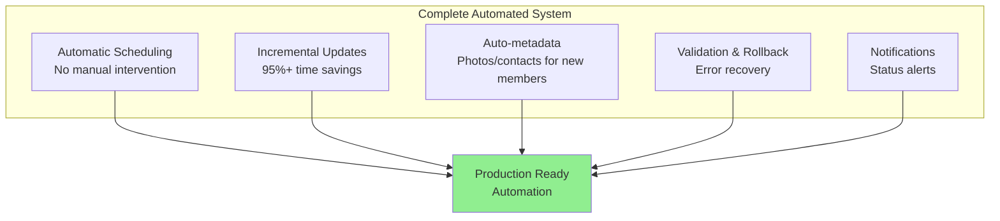

**Total Setup Time**: 30-45 minutes (with existing databases)

**Ongoing Runtime**:
- JudicialCache: 5-15 min weekly
- ExecutiveCache: 10-20 min weekly
- CivicCache: 10-25 min daily

**Maintenance**: Near-zero (just monitor notifications)

---

## Next Steps

1. ✅ Import workflow JSON
2. ✅ Fix question marks (click/save nodes)
3. ✅ Configure notifications (Discord/Email)
4. ✅ Test each project pipeline manually
5. ✅ Test validation & rollback
6. ✅ Activate workflow
7. ✅ Monitor first scheduled runs
8. 🎉 Enjoy fully automated Cache updates!

Your unified automation is ready to run! 🚀
