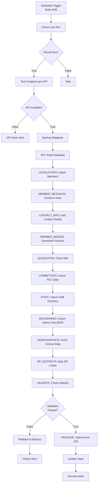

# n8n Workflow Setup for CivicCache

## Overview

This document provides comprehensive setup instructions for the CivicCache automation workflow in n8n. The workflow automates the complete data pipeline for fetching congressional, legislative, and campaign finance data for the CivicScope iOS app.

## Pipeline Architecture

The CivicCache pipeline consists of 12 sequential stages:

```
1. INIT              → Database initialization
2. LEGISLATORS       → Import current Congress members (unitedstates/congress-legislators)
3. MEMBER_METADATA   → Enhance with Congress.gov API metadata
4. CONTACT_INFO      → Import member contact information
5. MEMBER_IMAGES     → Import official portrait images
6. LEGISLATION       → Fetch bills and resolutions from Congress.gov
7. COMMITTEES        → Import FEC committee data
8. STAFF             → Import congressional staff data
9. BOUNDARIES        → Import congressional district boundaries (GeoJSON)
10. DEMOGRAPHICS     → Import district demographics (Census Bureau API)
11. ZIP_DISTRICTS    → Import ZIP code to district mappings
12. VALIDATE         → Database integrity validation
13. PACKAGE          → Package for CivicScope app distribution
```

## Pipeline Stage Details

### Stage 1: Initialize Database (INIT)
**Script**: `scripts/build_database.py`
**Purpose**: Creates fresh SQLite database with normalized schema
**Output**: `data/civic_cache.db` (~15-20 MB)
**Features**:
- Creates normalized schema (congress_members, states, legislation, committees)
- 15+ comprehensive indexes for fast queries
- FTS5 full-text search indexes
- Foreign key constraints for data integrity

### Stage 2: Import Legislators (LEGISLATORS)
**Script**: `scripts/import_congress_legislators.py`
**Purpose**: Downloads current Congress members from unitedstates/congress-legislators repository
**Source**: https://github.com/unitedstates/congress-legislators
**Data**: ~537 current members (119th Congress)
**Output**: Base congress_members table population
**Format**: JSON with bioguide IDs, names, terms, party affiliations

### Stage 3: Enhance Member Metadata (MEMBER_METADATA)
**Script**: `scripts/import_member_positions.py`
**Purpose**: Enriches member data with Congress.gov API metadata
**API**: Congress.gov API (requires CONGRESS_GOV_API_KEY)
**Data Added**:
- Leadership positions (Speaker, Majority Leader, etc.)
- Total years served and terms
- Sponsored bills count
- Cosponsored bills count
- Committee memberships
**Rate Limit**: 5,000 requests/hour

### Stage 4: Import Contact Information (CONTACT_INFO)
**Script**: `scripts/import_member_contact_info.py`
**Purpose**: Adds office addresses, phone numbers, website URLs
**Source**: congress-legislators repository (legislators-current.yaml)
**Data Added**:
- Office address
- Phone number
- Official website URL
- Contact form URL
- Social media handles (Twitter, Facebook, YouTube)

### Stage 5: Import Member Images (MEMBER_IMAGES)
**Script**: `scripts/import_member_images.py`
**Purpose**: Downloads official portrait images from Congress.gov
**API**: Congress.gov depiction API
**Output**: Updates `depiction_url` and `depiction_attribution` columns
**Image Format**: JPEG URLs pointing to official congressional portraits
**Fallback**: Uses placeholder or Wikipedia images if official portrait unavailable

### Stage 6: Fetch Legislation (LEGISLATION)
**Script**: `scripts/import_legislation.py`
**Purpose**: Downloads bills and resolutions from Congress.gov API
**API**: Congress.gov API (requires CONGRESS_GOV_API_KEY)
**Data**:
- Bill metadata (number, title, introduced date, latest action)
- Sponsors and cosponsors
- Bill status and latest action
- Committee referrals
- ~10,000-15,000 bills per Congress
**Arguments**: `--congress 119 --incremental`
**Rate Limit**: 5,000 requests/hour (throttle to ~80/minute for safety)

### Stage 7: Import FEC Committees (COMMITTEES)
**Script**: `scripts/import_fec_committees.py`
**Purpose**: Downloads campaign finance committee data from OpenFEC API
**API**: OpenFEC API (requires OPENFEC_API_KEY)
**Data**:
- Committee names and IDs
- Committee types (House, Senate, Presidential, PAC, Super PAC)
- Treasurer names
- Designation (authorized vs independent)
- ~10,000-15,000 active committees
**Rate Limit**: 1,000 requests/hour (120/minute)

### Stage 8: Import Congressional Staff (STAFF)
**Script**: `scripts/import_congressional_staff.py`
**Purpose**: Imports congressional staff directory data
**Source**: House and Senate staff directories (via cdir_staff_extractor.py)
**Data**:
- Staff member names and titles
- Office assignments
- Phone numbers and email addresses
- ~15,000-20,000 staff members
**Note**: May require manual download of PDF directories first

### Stage 9: Import District Boundaries (BOUNDARIES)
**Script**: `scripts/import_district_boundaries.py`
**Purpose**: Imports congressional district boundary GeoJSON data
**Source**: US Census Bureau TIGER/Line shapefiles
**Data**: Simplified GeoJSON polygons for 444 congressional districts
**Output**:
- Option A: Simplified metadata (centroid, bounding box) for mobile (~2 MB)
- Option B: Full GeoJSON data for detailed mapping (~276 MB - not recommended for mobile)
**Recommended**: Use simplified metadata option for CivicScope mobile app

### Stage 10: Import District Demographics (DEMOGRAPHICS)
**Script**: `scripts/import_district_demographics.py`
**Purpose**: Fetches demographic data for each congressional district
**API**: US Census Bureau API (requires CENSUS_API_KEY)
**Data**:
- Population totals
- Median household income
- Educational attainment
- Age distribution
- Racial/ethnic composition
- Housing statistics
**Source**: American Community Survey (ACS) 5-Year Estimates
**Rate Limit**: No strict limit (be reasonable, ~100-200 requests/minute)

### Stage 11: Import ZIP Code Mappings (ZIP_DISTRICTS)
**Script**: `scripts/import_zip_districts.py`
**Purpose**: Maps ZIP codes to congressional districts for lookup features
**Source**: HUD USPS ZIP Code Crosswalk Files
**Data**: ~43,000 ZIP codes mapped to congressional districts
**Use Case**: "Find my representative" feature by ZIP code input

### Stage 12: Validate Database (VALIDATE)
**Purpose**: Comprehensive validation of database integrity
**Checks**:
- Minimum record counts (537 members, 10K+ bills, 10K+ committees)
- Foreign key integrity
- Required fields populated
- FTS5 indexes functional
- Image URLs accessible (sample check)
**Exit Codes**: 0 = success, 1 = validation failure

### Stage 13: Package for iOS (PACKAGE)
**Purpose**: Creates optimized database for iOS app distribution
**Steps**:
1. VACUUM database to reclaim unused space
2. ANALYZE to update query planner statistics
3. Compress database with gzip (optional)
**Output**: `data/civic_cache_release.db` (optimized for iOS bundle)
**Size**: ~15-20 MB (uncompressed) or ~4-6 MB (gzip compressed)

## Validation Criteria

The workflow validates the database using these thresholds:

```bash
MINIMUM_MEMBERS=535              # At least 535 members (537 expected)
MINIMUM_LEGISLATION=10000        # At least 10,000 bills/resolutions
MINIMUM_COMMITTEES=10000         # At least 10,000 FEC committees
MINIMUM_STAFF=15000              # At least 15,000 staff members
MINIMUM_DISTRICTS=444            # All 444 congressional districts
```

**Validation Script**:
```bash
#!/bin/bash
DB=/data/civic/civic_cache.db

if [ ! -f "$DB" ]; then
  echo "{\"valid\": false, \"error\": \"Database file not found\"}"
  exit 1
fi

MEMBERS=$(sqlite3 "$DB" "SELECT COUNT(*) FROM congress_members;" 2>/dev/null || echo "0")
LEGISLATION=$(sqlite3 "$DB" "SELECT COUNT(*) FROM legislation;" 2>/dev/null || echo "0")
COMMITTEES=$(sqlite3 "$DB" "SELECT COUNT(*) FROM fec_committees;" 2>/dev/null || echo "0")
STAFF=$(sqlite3 "$DB" "SELECT COUNT(*) FROM congressional_staff;" 2>/dev/null || echo "0")
DISTRICTS=$(sqlite3 "$DB" "SELECT COUNT(*) FROM congressional_districts;" 2>/dev/null || echo "0")

if [ "$MEMBERS" -lt 535 ]; then
  echo "{\"valid\": false, \"error\": \"Too few members: $MEMBERS (expected >= 535)\"}"
  exit 1
fi

if [ "$LEGISLATION" -lt 10000 ]; then
  echo "{\"valid\": false, \"error\": \"Too few bills: $LEGISLATION (expected >= 10000)\"}"
  exit 1
fi

if [ "$COMMITTEES" -lt 10000 ]; then
  echo "{\"valid\": false, \"error\": \"Too few committees: $COMMITTEES (expected >= 10000)\"}"
  exit 1
fi

if [ "$STAFF" -lt 15000 ]; then
  echo "{\"valid\": false, \"error\": \"Too few staff: $STAFF (expected >= 15000)\"}"
  exit 1
fi

if [ "$DISTRICTS" -lt 444 ]; then
  echo "{\"valid\": false, \"error\": \"Too few districts: $DISTRICTS (expected >= 444)\"}"
  exit 1
fi

echo "{\"valid\": true, \"members\": $MEMBERS, \"legislation\": $LEGISLATION, \"committees\": $COMMITTEES, \"staff\": $STAFF, \"districts\": $DISTRICTS}"
```

## Workflow Setup (Manual - 26 Steps)

### Step 1-3: Initial Setup
1. Open n8n web interface (http://localhost:5678)
2. Click "+ Add workflow" button
3. Set workflow name: "CivicCache Daily Pipeline"

### Step 4-6: Configure Trigger
4. Add "Schedule Trigger" node
5. Configure cron schedule: `0 4 * * *` (Daily 4:00 AM)
6. Connect to Function node

### Step 7-10: State Management
7. Add "Function" node: "Check Last Run"
8. Paste state check JavaScript (see below)
9. Add "IF" node: "Should Run?"
10. Configure condition: `{{ $json.should_run }} === true`

### Step 11-13: API Health Check
11. Add "HTTP Request" node: "Test Congress.gov API"
12. Configure URL: `https://api.congress.gov/v3/member?api_key=${CONGRESS_GOV_API_KEY}&limit=1`
13. Add "IF" node: "API Available?"

### Step 14: Database Backup
14. Add "Execute Command" node: "Backup Database"
15. Command: `cp /data/civic/civic_cache.db /data/civic/civic_cache_backup_$(date +%Y%m%d_%H%M%S).db`

### Step 15-26: Pipeline Stages
15. Add Execute Command nodes for each of the 13 stages
16. Connect stages sequentially: INIT → LEGISLATORS → MEMBER_METADATA → ... → PACKAGE
17. Add IF node after VALIDATE: "Validation Passed?"
18. Add Execute Command node for rollback (on validation failure)
19. Add Function node: "Update State" (after successful completion)
20. Add 3 NoOp nodes for notifications: "Success Alert", "Failure Alert", "API Down Alert"
21. Connect notification nodes to appropriate paths
22. Click "Save" and activate workflow

## JavaScript Functions

### Check Last Run State
```javascript
const fs = require('fs');
const stateFile = '/data/civic/pipeline_state.json';

// Check if state file exists
let state = { last_successful_run: null };
if (fs.existsSync(stateFile)) {
  const stateData = fs.readFileSync(stateFile, 'utf8');
  state = JSON.parse(stateData);
}

// Calculate if we should run (daily = 24 hours)
const now = new Date();
const shouldRun = !state.last_successful_run ||
  (now - new Date(state.last_successful_run)) > 24 * 60 * 60 * 1000;

return [{
  json: {
    should_run: shouldRun,
    last_run: state.last_successful_run,
    hours_since_last_run: state.last_successful_run
      ? Math.floor((now - new Date(state.last_successful_run)) / (1000 * 60 * 60))
      : null
  }
}];
```

### Update State on Success
```javascript
const fs = require('fs');
const stateFile = '/data/civic/pipeline_state.json';

const state = {
  last_successful_run: new Date().toISOString(),
  version: '1.0',
  workflow_id: $workflow.id,
  execution_id: $execution.id,
  members_processed: $json.members || 0,
  legislation_count: $json.legislation || 0
};

fs.writeFileSync(stateFile, JSON.stringify(state, null, 2));

return [{
  json: {
    state_updated: true,
    timestamp: state.last_successful_run,
    members: state.members_processed,
    legislation: state.legislation_count
  }
}];
```

## Notification Configuration

The workflow includes 3 notification trigger points (currently NoOp placeholders):

### Success Alert
**Trigger**: Pipeline completes successfully
**Recommended**: Discord webhook or email
**Message Template**:
```
✅ CivicCache Pipeline Success

- Congress Members: {{ $json.members }}
- Legislation: {{ $json.legislation }}
- FEC Committees: {{ $json.committees }}
- Staff: {{ $json.staff }}
- Districts: {{ $json.districts }}
- Execution Time: {{ $workflow.duration }} seconds
```

### Failure Alert
**Trigger**: Validation fails or error occurs
**Recommended**: Discord webhook with @mention or urgent email
**Message Template**:
```
🚨 CivicCache Pipeline Failure

- Error: {{ $json.error }}
- Stage: {{ $node["Validate Database"].json.stage }}
- Rollback: Database restored from backup
- Action: Manual investigation required
```

### API Down Alert
**Trigger**: Congress.gov API health check fails
**Recommended**: Discord webhook
**Message Template**:
```
⚠️ CivicCache API Unavailable

- API: Congress.gov
- Status: {{ $json.status_code }}
- Next Retry: Tomorrow 4:00 AM
```

## Environment Variables

Required environment variables (set in Docker Compose `.env` file):

```bash
# Congress.gov API Key (REQUIRED for metadata, legislation, images)
CONGRESS_GOV_API_KEY=your_api_key_here

# OpenFEC API Key (REQUIRED for committee data)
OPENFEC_API_KEY=your_api_key_here

# US Census Bureau API Key (REQUIRED for demographics)
CENSUS_API_KEY=your_api_key_here

# Optional: ProPublica Congress API (enhanced voting records)
PROPUBLICA_API_KEY=your_api_key_here
```

## Workflow Diagram



## Testing the Workflow

### Test Individual Stages
1. Right-click any Execute Command node
2. Select "Execute Node"
3. Check output in "Output" panel
4. Verify database updates: `sqlite3 /data/civic/civic_cache.db "SELECT COUNT(*) FROM [table_name];"`

### Test Complete Workflow
1. Click "Execute Workflow" button (manual trigger)
2. Monitor execution in real-time (~45-60 minutes total)
3. Check logs in n8n UI
4. Verify database file: `/data/civic/civic_cache.db`
5. Check state file: `/data/civic/pipeline_state.json`

### Test Rollback
1. Temporarily modify validation thresholds to fail
2. Run workflow
3. Verify rollback restores backup database
4. Check Failure Alert triggers
5. Restore original validation thresholds

## Monitoring

### n8n Dashboard
- Workflow execution history (last 100 runs)
- Average execution time (~45-60 minutes)
- Success/failure rate
- Error logs and stack traces

### File System Checks
```bash
# Check database size (should be ~15-20 MB)
ls -lh /data/civic/civic_cache.db

# Check last successful run timestamp
cat /data/civic/pipeline_state.json | jq '.last_successful_run'

# Count records in database
sqlite3 /data/civic/civic_cache.db "SELECT COUNT(*) FROM congress_members;"
sqlite3 /data/civic/civic_cache.db "SELECT COUNT(*) FROM legislation;"
sqlite3 /data/civic/civic_cache.db "SELECT COUNT(*) FROM fec_committees;"

# Check for errors in logs
tail -100 /git/CivicCache/logs/pipeline.log
```

### Common Issues

#### Issue: "CONGRESS_GOV_API_KEY not set"
**Cause**: Environment variable missing
**Fix**: Add `CONGRESS_GOV_API_KEY` to Docker Compose `.env` file and restart container

#### Issue: "Rate limit exceeded" errors from Congress.gov
**Cause**: Too many API requests too quickly (5,000/hour limit)
**Fix**: Workflow has built-in throttling. If still occurring, increase delays in import scripts.

#### Issue: "Database validation failed: Too few members"
**Cause**: unitedstates/congress-legislators repo not accessible or rate limited
**Fix**: Workflow will auto-rollback. Check GitHub API rate limits. Next run will retry.

#### Issue: "Census API timeout" errors
**Cause**: Demographics import timing out on slow connections
**Fix**: Increase timeout in `import_district_demographics.py`. Consider running this stage separately.

#### Issue: "Permission denied" errors
**Cause**: Docker volume mount permissions
**Fix**:
```bash
chmod -R 755 /Users/abrooks/GIT/CivicCache/data
chown -R 1000:1000 /Users/abrooks/GIT/CivicCache/data
```

## Maintenance

### Daily (Automatic via Workflow)
- ✅ Fetch new legislation introduced
- ✅ Update member metadata (committee changes, leadership)
- ✅ Refresh FEC committee data
- ✅ Validate integrity
- ✅ Package for iOS distribution

### Weekly (Manual)
- Review execution logs for patterns (n8n dashboard)
- Check disk space usage for database backups
- Verify API keys haven't expired
- Review notification alerts for recurring issues

### Congressional Session Changes (Manual - Every 2 Years)
- Update congress number in legislation import: `--congress 120`
- Verify all 537 current members imported correctly
- Check for new states/territories added
- Audit district boundary changes (redistricting years)

### Quarterly (Manual)
- Update Python dependencies (`pip install -U -r requirements.txt`)
- Review and clean up old database backups (keep last 10)
- Verify API rate limits haven't changed
- Test complete pipeline on fresh Docker container

## Performance Metrics

**Expected Execution Times**:
- INIT: ~5 seconds
- LEGISLATORS: ~30 seconds (download from GitHub)
- MEMBER_METADATA: ~3-5 minutes (537 API calls with throttling)
- CONTACT_INFO: ~10 seconds
- MEMBER_IMAGES: ~2-3 minutes (download 537 portrait URLs)
- LEGISLATION: ~20-30 minutes (incremental) or ~2-3 hours (full Congress)
- COMMITTEES: ~10-15 minutes (10K+ committees with pagination)
- STAFF: ~5-10 minutes (depends on PDF availability)
- BOUNDARIES: ~2-3 minutes (simplified) or ~20-30 minutes (full GeoJSON)
- DEMOGRAPHICS: ~15-20 minutes (444 districts, ~3-4 API calls each)
- ZIP_DISTRICTS: ~30 seconds
- VALIDATE: ~5-10 seconds
- PACKAGE: ~5 seconds
- **Total (daily incremental)**: ~45-60 minutes
- **Total (full rebuild)**: ~3-5 hours

**Resource Usage**:
- CPU: Low-Medium (single-threaded Python scripts)
- Memory: ~500 MB - 1 GB during execution
- Disk: ~15-20 MB (database) + ~50 MB (temp files and backups)
- Network: ~50-100 MB download (incremental) or ~500 MB - 1 GB (full rebuild)

## API Rate Limit Management

The workflow is designed to stay within API rate limits:

| API | Rate Limit | Workflow Throttle | Safety Margin |
|-----|-----------|------------------|---------------|
| Congress.gov | 5,000/hour | ~80/minute | 4,800/hour |
| OpenFEC | 1,000/hour (120/min) | ~100/minute | ~6,000/hour |
| Census Bureau | Unlimited | ~100/minute | No hard limit |
| ProPublica | 5,000/day | ~3/minute | ~4,300/day |

**Throttling Implementation**: Each import script has `time.sleep()` calls between requests to stay under limits.

## Next Steps

1. **Import Workflow JSON**: Use the companion `civiccache_workflow.json` file for quick setup
2. **Configure Notifications**: Replace NoOp nodes with Discord/Email nodes
3. **Obtain API Keys**: Follow API_KEY_SETUP.md to get all required keys
4. **Test Run**: Execute workflow manually before relying on daily schedule
5. **Monitor First Week**: Verify daily runs complete successfully
6. **Integrate with CivicScope**: Update iOS app to fetch latest database

## Related Documentation

- `/Users/abrooks/GIT/CivicCache/docs/DATABASE.md` - SQLite schema documentation
- `/Users/abrooks/GIT/CivicCache/docs/API_KEY_SETUP.md` - API key setup instructions
- `/Users/abrooks/GIT/CivicCache/docs/congressional_staff_table_plan.md` - Staff import details
- `/Users/abrooks/GIT/CivicCache/docs/GEOJSON_MIGRATION.md` - GeoJSON boundary format
- `/Users/abrooks/GIT/CivicCache/docs/N8N_AUTOMATION_PLAN.md` - Overall automation strategy
- `/Users/abrooks/GIT/CivicCache/docs/N8N_INSTALLATION_GUIDE.md` - n8n installation instructions
